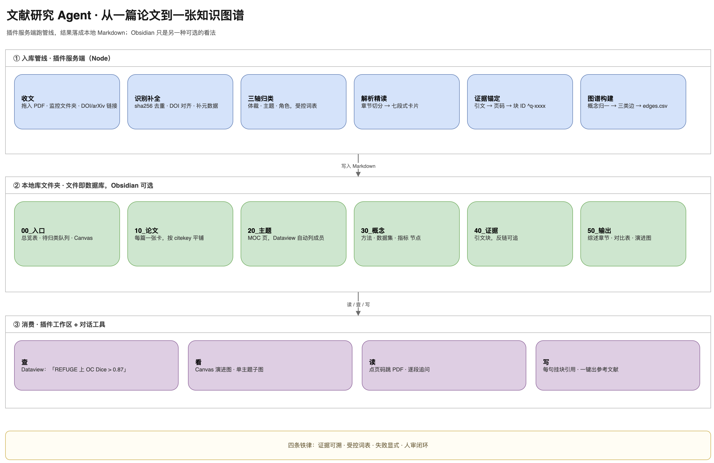

# 总体方案与搭建路线图（v2.0）

> **v2 变更（2026-11-04）**：产品定位由"写作副驾"调整为"**文献知识库**"，主流程由"检索优先"改为"**收文优先**"，新增**自动归类 / 证据链 / 知识图谱**三条主线；写作降为下游消费。
> 配套文档：[02 产品定位与场景](02_产品定位与场景.md) · [03 信息架构与知识模型](03_信息架构与知识模型.md)
> ⚠️ **v3 变更**：交付形态已改为 **DSH 插件**，技术栈由 Python 改为 Node/TypeScript。§2 架构、§6 选型、§7 排期以 [05 插件技术方案](05_插件技术方案.md) 为准；§1 目标、§4 设计决策、§9 风险仍适用。

---

## 0. 一页速览

| 项 | 结论 |
|---|---|
| 核心命题 | 论文进来 → 自动归位 → 拆成证据 → 连成图谱 |
| 主链路 | 收文 → 识别补全 → 三轴归类 → 解析精读 → 证据锚定 → 图谱构建 → 消费 |
| 形态 | **Obsidian 是前端与数据库**，Python 是后台工人 |
| 关键约束 | 块级证据、受控词表、失败显式 |
| 首个里程碑 | 30 篇跑通：三轴归类 ≥ 90%，卡片完整率 ≥ 95% |
| 总量级 | 单人 3–4 周（约 18 个工作日）做出 v1 |



**四条铁律**：

1. **证据可溯**——没有块引用的结论，不许进稿；
2. **受控词表**——类目与概念不自由生长，扩张必须"建议 → 人批"；
3. **失败显式**——识别/解析/归类失败全部进队列，宁可缺，不可猜；
4. **人审闭环**——归类、大纲、成稿三处强制人工确认。

---

## 1. 目标与验收

### 1.1 三个目标

| 目标 | 含义 | 现状对照 |
|---|---|---|
| **库能长大** | 每篇进来都有位置、有结构，半年后还能用 | 现在靠文件夹 + 脑子，35 篇已开始乱 |
| **每篇能读** | 打开卡片 10 分钟看懂，不用重读 PDF | 现在读完就忘，或读一半放弃 |
| **结论能查** | 任意论断可跳到原文页码，图谱可导航 | 现在靠 Ctrl+F 和记忆 |

### 1.2 验收标准

| 指标 | 目标 | 检验方式 |
|---|---|---|
| 三轴归类准确率 | ≥ 90% | 抽检 50 篇，人工核对 |
| 卡片字段完整率 | ≥ 95% | 30 篇逐字段核对 |
| 证据可核率 | 100% | 块引用全部可跳转、页码对得上 |
| 图谱边证据覆盖率 | 100% | 随机抽 50 条边，均能落到引文块 |
| 单篇处理 | ≤ 3 分钟 / ≤ ¥0.5 | 计时与 token 统计 |
| 30 篇端到端 | ≤ 2 小时（含人工确认） | 实测 |

### 1.3 边界

- v1 只做**个人本地库**，单用户、单机、中文优先；
- 不做 PDF 阅读器、不做浏览器插件、不做团队协作；
- 检索是**补充入口**（补漏、找对比），不是主入口。

---

## 2. 架构

### 2.1 五层 + 观测

```
L0 交互层    Obsidian（读、写、查） · CLI（入库、批处理）
L1 编排层    收文队列 + 阶段状态机 + 断点续跑 + 产物落盘
L2 能力层    识别器 · 归类器 · 解析器 · 精读器 · 证据抽取器 · 概念归一器 · 图谱构建器
L3 模型层    LLM(DeepSeek) · Embedding(bge-m3) · Reranker
L4 数据层    Markdown+frontmatter（主） · SQLite（索引/状态） · edges.csv（图）
L5 观测      每篇处理 trace、token 成本、失败原因
```

### 2.2 为什么是"文件即数据库"

- **可读**：你随时能打开、手改、git 版本化；
- **可移植**：Obsidian 的 Dataview / Canvas / 反链直接可用，不用写插件；
- **可恢复**：数据库坏了不影响内容，SQLite 只是索引，可重建；
- **代价**：复杂查询弱——用 Dataview + 预计算 CSV 补，可接受。

### 2.3 组件清单

| 组件 | 职责 | 输入 → 输出 |
|---|---|---|
| 收文器 | 监控文件夹 / 拖入 / DOI 解析 | PDF → 任务 |
| 识别器 | 哈希去重、DOI/标题对齐、元数据补全 | PDF → Paper 元数据 |
| 归类器 | 三轴判定 + 置信度 + 新类目建议 | 元数据+摘要 → topics/roles/type |
| 解析器 | 版面抽取、章节切分、质量评分 | PDF → 结构化全文 |
| 精读器 | 七段式卡片（逐节 map-reduce） | 全文 → Card |
| 证据器 | 抽可引句、生成块 ID、绑定页码 | 全文 → Evidence[] |
| 归一器 | 方法/数据集/指标对齐到受控概念 | Evidence → Concept |
| 图谱器 | 生成三类边、导出 edges.csv | 卡片+概念 → 图 |
| 校验器 | 块引用有效性、页码一致、覆盖率 | 稿件 → 审计报告 |

---

## 3. 主流程

### 3.1 入库管线（六步）

| # | 步骤 | 关键动作 | 失败处理 |
|---|---|---|---|
| ① | **收文** | 拖入 / 监控文件夹 / DOI·arXiv 链接 / 可选检索导入 | 非 PDF、加密、0 字节 → 拒收并说明 |
| ② | **识别补全** | sha256 去重 → DOI/标题对齐 → Crossref/OpenAlex 补元数据 | 无 DOI → 标题模糊匹配，仍失败进"待补全" |
| ③ | **三轴归类** | 体裁（规则）、主题（受控词表多标签）、角色（证据驱动） | 置信度 < 0.7 → 待归类队列 + 新类目建议 |
| ④ | **解析精读** | PyMuPDF 章节切分 → 质量评分 → 七段式卡片 | 扫描件 → MinerU 兜底 → 仍失败标 `unparsable` |
| ⑤ | **证据锚定** | 抽 3–5 条可引句 → 生成 `^q-xxxx` → 绑定页码/图表号 | 无页码信息 → 标 `no_anchor`，不生成块引用 |
| ⑥ | **图谱构建** | 概念归一 → `uses/improves_on/evaluates_on/reports` → `edges.csv` | 概念归不进去 → 挂"未归类概念"，不进图 |

### 3.2 消费（四类，都发生在 Obsidian 里）

| 消费 | 怎么用 | 依赖 |
|---|---|---|
| **查** | Dataview 查表："REFUGE 上 OC Dice > 0.87" | frontmatter 结构化 |
| **看** | Canvas 演进图 / 单主题子图 | 概念边 |
| **读** | 打开卡片逐段读，点页码跳 PDF，逐段追问 | 七段卡 + PDF 嵌入 |
| **写** | 草稿每句挂块引用，一键出参考文献 | 证据块 |

### 3.3 状态机

```
收文 ─▶ 已识别 ─▶ 已归类 ─▶ 已解析 ─▶ 已精读 ─▶ 已入图
          │           │          │          │
          └───────────┴──────────┴──────────┴──▶ 待人工（原因显式）
```

每篇论文在任何时刻都有唯一状态；`待人工` 必须带原因（缺 DOI / 扫描件 / 低置信 / 概念不认），不允许"卡住但不知道卡在哪"。

---

## 4. 关键设计决策

| # | 决策 | 选择 | 理由 |
|---|---|---|---|
| D1 | 数据底座 | Markdown + frontmatter 为主，SQLite 只做索引 | 可读、可改、可版本化；Obsidian 原生能力直接复用 |
| D2 | 归类 | 三轴 + 受控词表 + 待归类队列 | 单一目录装不下多维；自由生长必爆炸 |
| D3 | 证据载体 | Obsidian 块引用 `^q-xxxx` | 不用自研 ID 体系，原生可跳转、可反查 |
| D4 | 图谱 | 三层图，边必须挂 `evidence` | 防"LLM 联想图"，保证可审计 |
| D5 | 解析 | PyMuPDF 主 + MinerU 兜底 | 速度与版面兼顾，中文扫描件有退路 |
| D6 | 幂等 | 以 PDF 哈希 + 抽取版本为键缓存 | 重跑不重复烧 token，块 ID 稳定不变 |
| D7 | 模型分层 | 归类/筛选用便宜模型，精读/写作用强模型 | 成本可控 |
| D8 | 图数据库 | v1 不上 Neo4j | 百篇级用链接 + CSV 足够，省掉同步成本 |

---

## 5. 目录与数据模型

目录、frontmatter 契约、证据块写法、图谱 schema，统一见 [03 信息架构与知识模型](03_信息架构与知识模型.md) §3–§7。此处只强调一条：

> **`10_论文/` 平铺，不建二级目录。** 多维归类是属性与视图的事，不是搬文件的事。

---

## 6. 技术选型

| 层 | 选型 | 说明 |
|---|---|---|
| 语言/环境 | Python 3.11 + uv | 本机已有 uv，绕开系统 3.9 |
| PDF | PyMuPDF (fitz) | 快、带坐标；表格另用 pdfplumber |
| 兜底解析 | MinerU / Docling | 扫描件、公式、双栏 |
| 向量 | bge-m3 | 中英同空间，长段落友好 |
| 重排 | bge-reranker-v2-m3 | 证据检索提精度 |
| LLM | DeepSeek（deepseek-chat） | 中文强、便宜、支持 JSON 输出 |
| 存储 | Markdown + SQLite + CSV | 见 D1 |
| 视图 | Obsidian Dataview / Canvas | 不写插件（v1） |
| 图计算 | networkx | 只做预计算与导出，不做在线服务 |
| 观测 | structlog + trace 文件 | 每篇每步可追 |

---

## 7. 分阶段实施

| 阶段 | 工期 | 交付 | 验收 |
|---|---|---|---|
| **P0 契约与试标** | 2 天 | vault 骨架、类目树 v0、卡片 schema、10 篇试标 | 字段口径无歧义 |
| **P1 收文 + 归类** | 4 天 | 拖入/监控、去重、元数据、三轴分类、待归类队列 | 20 篇归类准确率 ≥ 85% |
| **P2 精读 + 证据** | 5 天 | 七段卡、块 ID、证据抽取、PDF 跳页 | 30 篇卡片完整率 ≥ 95% |
| **P3 图谱 + 消费** | 4 天 | 概念归一、三类边、Dataview/Canvas、逐段追问 | 抽 50 条边全部有出处 |
| **P4 打磨** | 3 天 | 批量回填、失败处理、成本与速度 | 30 篇 ≤ 2 小时 |

**节奏**：P0 的 10 篇试标是关键闸门——口径没定清楚就写代码，后面全是返工。

---

## 8. 评估

| 维度 | 方法 | 频率 |
|---|---|---|
| 归类准确率 | 50 篇人工抽检（三轴分别算） | 每次改 prompt |
| 卡片质量 | 30 篇标注集逐字段比对 | 每次改 schema |
| 证据有效性 | 块引用全部点击验证 + 抽 20 条核原文 | 每次出稿 |
| 图谱可信 | 抽 50 条边查 `evidence` | 每次重建图 |
| 成本/速度 | 自动记账 | 持续 |

固定回归集很重要：改一次 prompt 可能修好"角色"、弄坏"主题"，没有测试集就是盲改。

---

## 9. 风险

| 风险 | 影响 | 对策 |
|---|---|---|
| 类目爆炸 | 库变垃圾场 | 受控词表 + 每月体检 + 新类目需 ≥3 篇 |
| 图谱毛线球 | 好看但没用 | 只画有证据的边 + 默认单主题子图 |
| 只收藏不使用 | 覆盖率停滞 | 北极星盯"结构化覆盖率"，不盯篇数 |
| PDF 质量差 | 抽取失败 | 质量评分 + MinerU 兜底 + 显式标记 |
| 归类错分 | 信任崩塌 | 低置信进队列 + 一键修正 + 回流 few-shot |
| 模型幻觉 | 学术事故 | 只许引用库内块；校验器兜底 |
| 成本失控 | 钱包 | 哈希缓存 + 模型分层 + 批量 |
| 版权合规 | 法律风险 | 本地私有、不外传全文 |

---

## 10. 下一步

P0 第一件事：**用你 11 篇核心文献反推类目树 v0，并试标 3 篇卡片**，确认三轴与七段的字段口径。口径确认后再写第一行代码。
