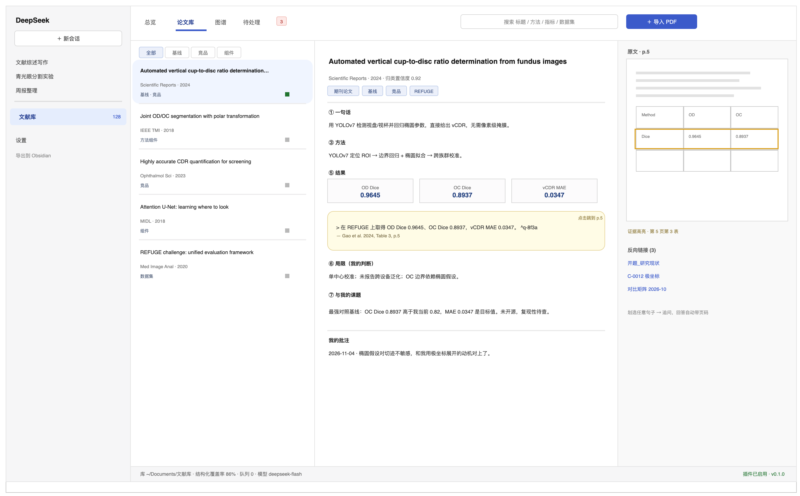

# 产品形态 v2 · DeepSeek Harness 插件

> **v2 变更（2026-11-04）**：交付形态改为**可安装的 DeepSeek Harness 插件**——`dsh plugin add` 装完即用，功能一个不少。
> **术语澄清**：这里的"插件"指 **DeepSeek Harness 插件包**（Cordis 插件，能进侧边栏、能开工作区、能给 Agent 加工具）；不是 chat.deepseek.com 的浏览器扩展——那边没有公开插件 API，做不了。

---

## 0. 一屏速览

| 项 | 形态 |
|---|---|
| 产品本体 | **一个 npm 包**：服务端插件 + 客户端界面 + 5 个 Agent 工具 |
| 安装 | `dsh plugin --profile desktop add <tgz>` → 重启 → 刷新 |
| 入口 | 侧边栏「文献库」；或在对话里直接说"把这篇收进库" |
| 界面 | 文献库工作区：总览 / 论文库（三栏）/ 图谱 / 待处理 |
| 数据 | 本地库文件夹（Markdown + PDF + index），Obsidian 可随时打开 |
| 依赖 | **无 Python、无本地模型、无外部服务**；模型复用宿主 |
| 功能 | 与原方案 1:1，见 §4 映射表 |

---

## 1. 安装（三步）

```bash
# 1) 安装（tgz 或 npm 包名）
dsh plugin --profile desktop add ./dsh-litkb-0.1.0.tgz

# 2) 重启 DSH / 刷新页面
# 3) 侧边栏出现「文献库」，首次进入选择一个库文件夹
```

| 操作 | 命令 | 数据 |
|---|---|---|
| 升级 | 再次 `add` 新版本，覆盖即可 | 不动 |
| 卸载 | `dsh plugin --profile desktop remove dsh-litkb` | 库文件夹保留 |
| 迁移 | 把库文件夹拷走，新机指向它 | 完整 |

**默认库位置**：`~/Documents/文献库/`（可在设置里改）。这个文件夹就是你的知识资产，插件只是它的编辑器。

---

## 2. 插件里有什么（三层）

| 层 | 内容 | 你感知到的 |
|---|---|---|
| **服务端** | 导入、解析、归类、抽取、建图、检索、导出；路由 `/api/litkb/*` | 处理进度、后台队列 |
| **客户端** | 侧边栏入口 + 文献库工作区 + 内嵌 PDF + 图谱 | 你每天点的界面 |
| **工具** | `lit_import` / `lit_search` / `lit_card` / `lit_graph` / `lit_cite` | 在对话里直接使唤它 |

**关键**：工具是给 Agent 用的——你在对话里说"把刚才那个 PDF 收进库，按大类与标签，然后告诉我它能不能当 baseline"，模型会自己调 `lit_import` → `lit_card`，结果直接出现在侧边栏。

---

## 3. 六个面

| 面 | 你做什么 | 系统做什么 |
|---|---|---|
| **S0 收文** | 拖 PDF 进工作区 / 点"导入" / 对话里给链接 | 去重、补元数据、大类与标签，几秒到几分钟 |
| **S1 总览** | 看库的全貌 | 总篇数、覆盖率、待处理队列、最近导入 |
| **S2 论文库** | 左列表 + 中卡片 + 右 PDF | 七段卡、证据块、页码跳转、反向链接 |
| **S3 图谱** | 看方法演进、谁和谁可比 | 力导向图 + 演进时间线 + 可比组表 |
| **S4 精读** | 划线、追问 | 回答带本文页码；批注写回卡片 |
| **S5 输出** | 写综述、导出 | 句句挂引用，导出 Markdown / BibTeX / Obsidian 库 |



---

## 4. 功能映射：一个都不能少

| # | 能力 | 原形态（Obsidian） | 插件形态 | 是否等价 |
|---|---|---|---|---|
| 1 | 收文 | 拖进 `Inbox/` | 拖拽 / 导入按钮 / 对话指令 | ✅ 更强（三种入口） |
| 2 | 大类与标签 | 后台 Python 管线 | 服务端归类器，结果可一键改 | ✅ |
| 3 | 七段式卡片 | Markdown 文件 | 卡片视图（底层仍是同一份 Markdown） | ✅ |
| 4 | 证据链 | 块引用 `^q-xxxx` | 块引用 + 内嵌 PDF 高亮 | ✅ 更强 |
| 5 | 知识图谱 | Obsidian Canvas | 内嵌力导向图 + 导出 Canvas | ✅ 更强 |
| 6 | 逐篇精读 | Obsidian + 外部模型 | 卡片内划线即问，复用当前会话 | ✅ 更强 |
| 7 | Obsidian 兼容 | 主形态 | 同一文件夹可直接用 Obsidian 打开 | ✅ 保留 |
| 8 | 写作 / 参考文献 | Markdown + BibTeX | 导出 Markdown / BibTeX / GB/T 7714 | ✅ |
| 9 | 库的长期可读 | 纯文件 | 纯文件（同 1） | ✅ |

**没有一项被砍。** 变的是"谁来渲染界面"，不是"有没有这个功能"。

---

## 5. 一天的样子

| 时间 | 发生什么 |
|---|---|
| 07:50 | 你把 3 篇 PDF 拖进文献库工作区，出门 |
| 08:00 | 右上角提示"3 篇已入库，1 篇归类待确认" |
| 09:10 | 点开待处理，把 1 篇改到"拓扑约束"类目 |
| 09:20 | 在论文库里点开 Gao2024，中栏读卡片，右栏 PDF 自动跳到第 5 页 |
| 09:30 | 划选"OC Dice 0.8937"→ 追问"它和我现在的 0.82 差在哪"，回答带页码 |
| 14:00 | 新建会话："用文献库写研究现状里'极坐标'那段" → 模型调 `lit_cite`，段落带引用 |
| 周末 | 打开图谱页，发现"拓扑约束"只有 2 篇，决定补 3 篇 |

---

## 6. 与宿主的关系

| 宿主能力 | 插件怎么用 | 好处 |
|---|---|---|
| 模型 | 复用你已登录的 DeepSeek 模型 | 不用另配 API key、不用另付费 |
| 会话 | 追问落在当前对话，产物可 @ 引用 | 不丢上下文 |
| 权限 / 沙箱 | 文件读写走宿主权限 | 不会偷偷乱写 |
| 设置页 | 插件卡片里配库路径、类目树、阈值 | 不用改配置文件 |
| 卸载 | 删除插件 | 库文件夹完好，Obsidian 照样能开 |

---

## 7. 代价（诚实说）

| 代价 | 原因 | 缓解 |
|---|---|---|
| 解析精度略降 | 浏览器/Node 端用 pdfjs，不如 PyMuPDF | 质量评分 + 低分转 OCR 服务（可选） |
| 无本地向量检索 | 装 bge-m3 会破坏"安装即用" | BM25 + LLM 重排，百篇级够用 |
| 大库性能 | 前端渲染 + 内存索引 | 分页、懒加载；500 篇以上再上 SQLite |
| 跟随宿主版本 | 插件 API 会变 | 锁版本 + 回归测试 |

---

## 8. 边界

- v1：单用户、单机、本地库；
- 不做移动端、不做多人协作、不做浏览器插件、不替代 Zotero；
- 不把内容锁进插件——**库文件夹永远是纯 Markdown + PDF**。

---

## 9. 交付物

1. `dsh-litkb-0.1.0.tgz`（安装包）
2. 库模板（六类目录 + 类目树 `topics.yaml` + 空索引）
3. 30 篇试标数据（回归基线）
4. 一页安装说明 + 一页使用说明

> 技术实现见 [05 插件技术方案](05_插件技术方案.md)。
