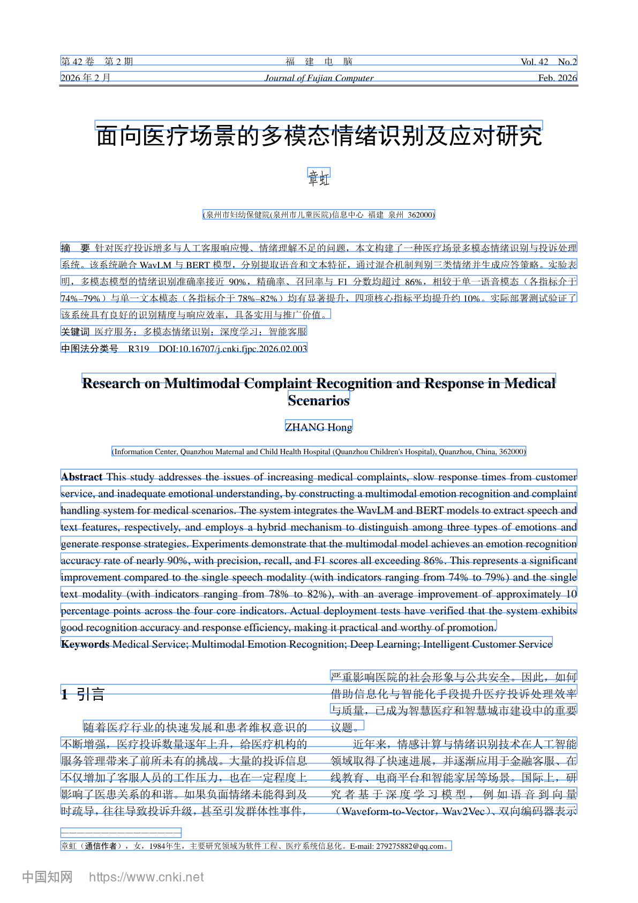

# 插件技术方案（SDD · v2.18）

> 目标：一个 `dsh plugin add` 就能装上的包，功能覆盖原方案全部能力。
> 结论：**Node-only 双端插件**（服务端 + 客户端）+ **9 个 Agent 工具**；库是本地文件夹，Obsidian 只是它的可选查看器。当前 v0.1.1 注册 63 条 HTTP 路由。

| 项 | 内容 |
|---|---|
| 版本 | **v2.18** |
| 日期 | 2026-11-06 |
| 状态 | 已确认（P4.11 + P1 + P2/P3 + 场景补齐已落地） |
| 关联 | [PRD v1.32](06_PRD.md) · [信息架构 v2.4](03_信息架构与知识模型.md) · [需求规格书 v1.31](07_需求规格书.md) |

> **v1.1 变更（2026-11-05）**
> 1. 解析从"页级文本"升级为**块级版面**：`blocks/<id>.json`，每块带页码、bbox、角色、章节；
> 2. 新增**页图渲染**与**双向定位**：点解析块高亮 PDF 区域，点 PDF 区域回到解析块；
> 3. 新增**中英对照**：按块翻译、三视图、术语表、译后校验、按块缓存；
> 4. 证据从"页码"升级为"页码 + 版面块 ID"，七段卡的引文可精确高亮；
> 5. 待确认项见 §9；确认后同步 SRS / 信息架构 / 开发计划（清单见 §10）。
>
> **v1.2 变更（2026-11-05，P3）**
> 1. 新增 `concepts/concepts.json`（受控词表 + 待归一）与 `concepts/edges.jsonl`（全库边表）；
> 2. 新增**边抽取任务**：七段卡 + 证据 → 模型 → 校验 → 落盘；每条边必须引用卡内 evidence_id；
> 3. 新增**图谱页**（Canvas 力导向、过滤、边看证据）与**可比组**；
> 4. 新增**划词追问**：解析稿块 / 卡片正文选区 → 本文材料 → `[p.N]` 约束与越界校验；
> 5. 三栏主屏与 PDF 页图文本层划词**评估后延后 P4**（D11/D12）。
>
> **v1.3 变更（2026-11-05，P4 界面融合）**
> 1. 文献库从 `shell.overlay` 迁到原生 `main` 面板，侧边栏使用 `sidebar.panellist`；
> 2. 工作区收敛为「论文库 / 图谱」两个页签，总览变 KPI 条、未归类变筛选；
> 3. 论文库三栏：列表 ｜ 详情/解析稿 ｜ 右栏（原文/证据/信息/追问）；
> 4. 标签与术语表合并到「标签与术语」管理页；解析稿不再内嵌术语表；
> 5. 追问改为右栏内联，不再弹窗；窄屏自动收起列表并提供页头筛选/选论文。
>
> **v1.4 变更（2026-11-05，P4.6 导出与反链）**
> 1. 新增 `lib/export.js`：BibTeX、GB/T 7714、卡片 MD、Mermaid、Canvas；
> 2. 新增 `GET /api/litkb/export`（format + id/scope）；
> 3. 证据反链 UI 开放，卡片证据旁「反链」展开文件/行号/文本；
> 4. 整库 vault 打包留后续。
>
> **v1.5 变更（2026-11-05，P4.7 写作）**
> 1. 新增 `drafts/*.md` 与 `lib/drafts.js`：CRUD、自动保存、引用解析、参考文献；
> 2. 新增写作页（第三页签）与引用搜索；
> 3. 反链扫描增加 `drafts/`；
> 4. 新增 `drafts/assist` 按证据扩写（只许引用选中证据）。
>
> **v1.6 变更（2026-11-05，写作编辑器）**
> 1. 写作区改为编辑/分栏/预览三模式，内置轻量 Markdown 渲染；
> 2. 引用 `[[paper#^q-id|label]]` 在预览中渲染为可点击 chip；
> 3. 工具栏支持 H2/加粗/列表/引用，直接改 body。
>
> **v1.7 变更（2026-11-05，P4.9 精读）**
> 1. 新增 `deepread/<paperId>.json` 与 `lib/deepread.js`；
> 2. 后台精读任务：原文 + 卡片 → 结构 → 回贴 q-id；
> 3. 新增 `/deepread/build`、`/deepread`；精读页签。
>
> **v1.8 变更（2026-11-05，精读 11 板块）**
> 1. 精读输出改为 11 板块 Markdown，不再输出 claim/evidence JSON；
> 2. prompt 明确禁止大段抄原文；缺信息写「原文未说明」；
> 3. `parseDeepSections` 兜底补齐缺失板块；页码 `[p.N]` 在 UI 中可点。
>
> **v1.9 变更（2026-11-05，数值核对）**
> 1. `auditNumbers` 对精读数值逐项回原文查找；
> 2. 找到的生成 q-id 并追加到卡片证据，找不到的标 unverified；
> 3. 精读文件增加 `numbers`，UI 渲染核对表。
>
> **v2.0 变更（2026-11-05，P4.10 论证链）**
> 1. 新增 `chains/<id>.json` 与 `lib/chains.js`：claim + 节点关系；
> 2. 三种提议（论点/证据/问题），AI 只提议、用户确认后落库；
> 3. 7 条 `/chains*` 路由；精读「用它建链」、写作右栏「证据链」、中栏 `ChainCanvas`；
> 4. 插入文稿生成带 q-id 的论证段；失效节点标 stale。
>
> **v2.18 变更（2026-11-06，导航重排）**
> 1. 精读命名/导航隐藏；
> 2. 概念图谱 UI 暂隐藏；
> 3. 横向精读顶层页签。
>
> **v2.17 变更（2026-11-06，横向差异）**
> 1. compare 差异检测/数字高亮；
> 2. 板块对比链、存为文稿。
>
> **v2.16 变更（2026-11-06，场景补齐）**
> 1. `lib/link-import.js` + `/import/link`；
> 2. `/deepread/compare` + 横向精读；
> 3. `lit_graph` / `lit_blocks`。
>
> **v2.15 变更（2026-11-06，P2/P3）**
> 1. 检索过滤/复制/存为文稿；
> 2. 跨论文主题/概念强配对；
> 3. Agent 工具引用渲染。
>
> **v2.14 变更（2026-11-06，P1）**
> 1. `lib/chain-cross.js` 跨论文 claim 配对/关系/草稿；
> 2. `/chains/auto/run` `mode:'cross'`；
> 3. `lib/search-history.js` + `/search/history`。
>
> **v2.13 变更（2026-11-06，P4.11）**
> 1. `autoChainDrafts` + 后台任务 + 审核 API；
> 2. `lib/search.js` BM25、`lib/answer.js` 链优先答案与引用校验；
> 3. `lib/agent-tools.js` 7 个 `lit_*` 工具，`confirm` 写保护。
>
> **v2.12 变更（2026-11-06，反馈修复）**
> 1. 图谱 tooltip 使用 `--litkb-surface-2`；
> 2. 写作三栏/编辑预览拖拽 + localStorage；
> 3. 概念图谱改用 Cytoscape（`CONCEPT_PALETTES`/`conceptGraphStyle`），保留旧 Canvas 函数供测试/回退。
>
> **v2.11 变更（2026-11-06，UI P4）**
> 1. Workspace 窄屏列表/右栏抽屉；
> 2. ChainDialog 焦点 trap + 返回焦点；
> 3. tertiary 文字对比度 AA、Esc 优先级。
>
> **v2.10 变更（2026-11-06，UI P3）**
> 1. 写作专注模式 / AI 扩写意图；
> 2. 图谱 `GRAPH_PALETTES` 浅深两套 + `detectThemeMode` 运行时切换；
> 3. 建链弹窗 token 收口。
>
> **v2.9 变更（2026-11-06，UI P2）**
> 1. 右栏证据行 / p.N 胶囊 / 2 行引文；
> 2. 精读左侧 11 板块 sticky 导航 + 滚动高亮；
> 3. 解析稿 hover「追问/建链」与选中竖线。
>
> **v2.8 变更（2026-11-06，UI P1）**
> 1. Workspace 两行头部：搜索 + 导入 / 页签 + KPI；
> 2. 论文列表行重构（状态点/两行标题/标签/胶囊）与 5 行骨架；
> 3. Detail 两行标题栏 + 状态 + 打开原文。
>
> **v2.7 变更（2026-11-06，UI P0）**
> 1. 新增 `--litkb-*` 设计令牌层；
> 2. 消灭 `fill-l1`/`label-tertiary`/`state-accent-primary` 无效令牌；
> 3. 最小字号 11px、全局 focus-visible、行内按钮 24px。
>
> **v2.6 变更（2026-11-05，建链弹窗可读性）**
> 1. 弹窗改双栏：左论点/节点，右证据选择器；
> 2. 选择器默认本论文卡片证据（`/card`），可切全库（`/evidence/search`）；
> 3. 文本改用主题主/次色与 `bg-layer-1`，修浅色主题对比度。
>
> **v2.5 变更（2026-11-05，全库论文上图）**
> 1. 有链时 `chainGraph` 返回全库论文；未建链论文 `unchained:true`；
> 2. 未建链论文虚化、排下方网格，统计「未建链 N」；点开可去建链。
>
> **v2.4 变更（2026-11-05，节点可读性）**
> 1. 节点数据增加 `short`（≤10 字）与 `full`；图上画 short，详情/悬停用 full；
> 2. 论点蓝 / 证据绿 / 论文紫；关系边与标签分色；失效黄虚线；
> 3. 图例、统计条按类型着色，画布加点阵背景。
>
> **v2.3 变更（2026-11-05，证据链知识库）**
> 1. 图谱页首屏改为 Cytoscape.js 证据链图（claim/evidence/paper）；
> 2. 新增 `/chains/graph`、`/chains/layout`、`/vendor/cytoscape.js`；
> 3. 本地 vendored 图引擎，布局存 `chains/.layout.json`；概念图谱保留。
>
> **v2.2 变更（2026-11-05，弹窗建链）**
> 1. 建链从写作页中栏改为 `ChainDialog` 弹窗，不改变页签；
> 2. 右栏「证据」tab 增加「证据链」分段（按论文过滤）；
> 3. 弹窗内选文稿插入，新增 `appendChainToDraft` 与 `insert` 的 `append` 参数。
>
> **v2.1 变更（2026-11-05，原文段落建链）**
> 1. 解析稿每段「建链」：取该段首句当 claim 草稿；
> 2. 该段无 q-id 时按段落原文补一条证据（block=该段），重复点不会重复建；
> 3. `origin` 增加 `block`；页眉页脚拒绝建链；
> 4. 仍走 `/chains/propose` 与 `ChainCanvas`，不新增路由。

---

## 0. 为什么是"双端插件"

DSH 的插件是 Cordis 插件，一个包可以同时提供：

| 端 | 入口 | 能力 |
|---|---|---|
| 服务端 | `lib/index.js` | 注册 HTTP 路由、后台任务、Agent 工具 |
| 客户端 | `lib/client.js` | 注入侧边栏、工作区、设置卡片 |

已装在你机器上的 `dsh-worktable` 就是同一套协议：服务端注册 `/api/worktable/*`，客户端经 slot 注入侧边栏与 `shell.overlay`。照抄它的骨架即可。

---

## 1. 包结构

```
dsh-litkb/
├── package.json          # dsh.bundle.patch + dsh.client.inject
├── dsh.plugin.json       # 清单：name / entry / client.platform
├── cordis.patch.yml      # insert: - id: dsh-litkb  name: dsh-litkb
├── lib/
│   ├── index.js          # 服务端：路由 + 任务队列
│   ├── layout.js         # 版面块：items → lines → blocks → roles（新增）
│   ├── blocks.js         # blocks.json 读写、块锚点 Markdown（新增）
│   ├── render.js         # 页图渲染 + 缓存（新增）
│   ├── translate.js      # 翻译任务、分批、校验、缓存（新增）
│   ├── glossary.js       # 术语表读写（新增）
│   ├── cards.js          # 七段卡落盘与 Markdown
│   ├── sections.js       # 章节切分
│   ├── evidence.js       # 引文回贴原文
│   ├── concepts.js       # 概念词表、归一、合并、待归一队列（P3）
│   ├── graph.js          # 边抽取、校验、edges.jsonl、可比组（P3）
│   ├── ask.js            # 划词追问、上下文组装、页码校验（P3）
│   ├── drafts.js         # 写作文稿（P4.7）
│   ├── deepread.js       # 精读 11 板块（P4.9）
│   ├── chains.js         # 论证链 + 证据链图（P4.10/P4.10+）
│   ├── pdftext.js        # 分页分行文本
│   ├── vendor/           # cytoscape.min.js（MIT，图引擎）
│   └── client.js         # 客户端：window.__ModuleLoader__.load 握手
├── prompts/
│   ├── seven-sections.v1.md
│   ├── translate-zh.v1.md
│   ├── graph-extract.v1.md   # P3 卡片→概念/边
│   ├── graph-normalize.v1.md # P3 候选→已有概念
│   └── ask-page-cited.v1.md  # P3 划词追问
└── tests/
```

`package.json` 关键字段不变；新增直接依赖 **`@napi-rs/canvas`**（页图渲染，pdfjs 已把它列为可选依赖，改为显式依赖避免装不上）。

---

## 2. 三条运行线

### 2.1 HTTP 路由（服务端）

| 路由 | 作用 | 版本 |
|---|---|---|
| `POST /api/litkb/import` | 收文（上传 / 路径 / DOI） | P1 |
| `GET /api/litkb/papers` | 列表（筛选、分页） | P1 |
| `GET /api/litkb/card` | 卡片 + 生成任务 + 模型可用性 | P2.1 |
| `POST /api/litkb/card/generate` | 七段卡生成（串行队列） | P2.1 |
| `GET /api/litkb/pdf` | 原文 PDF 流 | P2.1 |
| **`GET /api/litkb/blocks`** | **解析块 + 版面质量 + 解析任务** | **P2.2** |
| **`POST /api/litkb/blocks/build`** | **块级解析（可强制重建）** | **P2.2** |
| **`GET /api/litkb/page`** | **页图 PNG（`page`、`dpi`、`ETag`）** | **P2.2** |
| **`POST /api/litkb/translate`** | **整篇 / 本章 / 本块翻译（任务）** | **P2.3** |
| **`GET /api/litkb/translate`** | **翻译任务与译文读取** | **P2.3** |
| **`GET/POST /api/litkb/glossary`** | **术语表读写** | **P2.3** |
| **`GET/POST /api/litkb/settings`** | **本地设置（PaddleOCR 令牌/模型）** | **P2.2** |
| **`GET /api/litkb/graph`** | **节点 + 边 + 构建任务 + 待归一数** | **P3** |
| **`POST /api/litkb/graph/build`** | **概念/边抽取（串行任务；增量或 force）** | **P3** |
| **`GET /api/litkb/concepts`** | **受控词表 + 待归一队列** | **P3** |
| **`POST /api/litkb/concepts/merge`** | **合并两个概念（别名并入，边重指）** | **P3** |
| **`POST /api/litkb/concepts/update`** | **改名 / 加别名 / 批准待归一** | **P3** |
| **`GET /api/litkb/compare`** | **可比组（数据集 + 指标）** | **P3** |
| **`POST /api/litkb/ask`** | **划词追问（同步，页码校验）** | **P3** |
| `POST /api/litkb/export` | 导出 md / bib / canvas | P4 |
| **`GET /api/litkb/export`** | **BibTeX / GB-T / 卡片 MD / Mermaid / Canvas** | **P4.6** |
| **`GET/POST /api/litkb/drafts`** | **文稿列表 / 新建** | **P4.7** |
| **`GET/POST /api/litkb/drafts/read`、`/save`** | **读 / 保存文稿** | **P4.7** |
| **`GET /api/litkb/drafts/export`** | **导出带参考文献的 MD** | **P4.7** |
| **`GET /api/litkb/evidence/search`** | **全库证据搜索** | **P4.7** |
| **`POST /api/litkb/drafts/assist`** | **AI 按证据扩写** | **P4.7** |
| **`POST /api/litkb/deepread/build`** | **生成/重跑精读** | **P4.9** |
| **`GET /api/litkb/deepread`** | **读精读 + 任务状态** | **P4.9** |
| **`GET /api/litkb/chains`、`/chains/read`** | **论证链列表 / 单条** | **P4.10** |
| **`POST /api/litkb/chains/save`、`/delete`** | **保存 / 删除论证链** | **P4.10** |
| **`GET /api/litkb/chains/claims`** | **精读论点候选** | **P4.10** |
| **`POST /api/litkb/chains/propose`** | **四种建链候选（不落库）** | **P4.10 / v0.16.1** |
| **`POST /api/litkb/chains/insert`** | **生成带引用的论证段** | **P4.10** |
| **`GET /api/litkb/chains/graph`** | **证据链知识库图（claim/evidence/paper + stats）** | **P4.10+** |
| **`POST /api/litkb/chains/layout`** | **保存节点坐标** | **P4.10+** |
| **`GET /api/litkb/vendor/cytoscape.js`** | **本地 Cytoscape.js 文件** | **P4.10+** |

### 2.2 客户端界面

| 位置 | 内容 |
|---|---|
| 侧边栏 | `sidebar.panellist` 书本图标，与 Plugins/Schedules 并列 |
| 工作区 | 原生 `main` 面板；论文库 / 写作 / 图谱三个页签 |
| 论文库 | KPI 条 + 筛选（全部/未归类/状态）+ 三栏：列表 ｜ 详情/七段卡/精读·解析稿 ｜ 右栏 |
| 右栏 | 原文（连续滚动/缩放/p.N 定位）/ 证据 / 信息 / 追问 |
| 窄屏 | <1260px 自动收起列表；页头提供筛选/选论文/论文列表抽屉 |
| 管理 | 「标签与术语」：标签增删/关键词/重跑 + 术语表增删改 |
| 设置 | 原生 `settings.section`：库路径（只读）、PaddleOCR、模型状态 |
| 写作 | 文稿列表 ｜ Markdown 编辑/分栏预览 ｜ 引用库/参考文献/证据链 |
| 证据链 | 精读/解析稿段落/证据行 → **弹窗**构建；右栏「证据」tab 看证据与链；节点可跳 p.N/block，可插入文稿 |
| 知识库图 | 图谱页首屏 Cytoscape 证据链图：拖动节点、缩放、搜索、详情、打开链/回原文；位置自动保存 |
| 图谱 | 力导向图 + 主题/年份/类型过滤；右栏节点/边详情与证据；「可比组」子页；待归一队列 |
| 追问 | 解析稿块 / 卡片正文划选 → 浮动「追问」→ 回答 `[p.N]` 可点跳页；可存批注 |

布局：

```
┌──────────────┬──────────────────────────────┬──────────────────┐
│ 论文列表 320 │ 详情 / 七段卡 / 解析稿平铺    │ 原文/证据/信息/追问│
│ 筛选 + KPI   │                              │ 380–520（可拖）   │
└──────────────┴──────────────────────────────┴──────────────────┘
```

### 2.3 Agent 工具

| 工具 | 作用 | 版本 |
|---|---|---|
| `lit_import` | 收文并归类 | P1 |
| `lit_search` | 语义/关键词检索 | P3 |
| `lit_card` | 取/生成七段卡 | P2 |
| `lit_blocks` | 取某页/某节的解析块与 bbox | P2.2 |
| `lit_translate` | 取某块/某节的中文 | P2.3 |
| `lit_graph` | 查概念邻居、可比组 | P3 |
| `lit_cite` | 返回带页码的引用块 | ✅ P4.11 |
| `lit_answer` | 链优先答案 + 引用 + trace | ✅ P4.11 |
| `lit_chain_propose/save/get` | 建链草稿/确认保存/读取 | ✅ P4.11 |

工具返回结构化 JSON，前端渲染成卡片，避免"模型复述一遍"。v0.28.0 实际注册 **9 个** `lit_*`：`lit_search / lit_answer / lit_chain_get / lit_chain_propose / lit_chain_save / lit_card / lit_cite / lit_graph / lit_blocks`；保存链必须 `confirm:true`。

---

## 3. 数据：库就是一个文件夹

```
文献库/
├── papers/            # PDF 原件，sha256 命名
├── text/              # <id>.txt（纯文本）+ <id>.pages.json（分页分行）
├── blocks/            # <id>.json（块真源）；<id>.md 导出时生成
├── cards/             # <id>.card.json + <id>.md（frontmatter + 七段 + 证据块）
├── translations/      # <id>.zh.json（按块缓存译文）
├── drafts/            # <id>.md 写作文稿（frontmatter + 正文 + 引用）
├── deepread/          # <id>.json 精读（11 板块 + 数值核对 + 证据索引）
├── chains/            # <id>.json 论证链（claim + 节点 + 关系）
├── concepts/
│   ├── concepts.json  # 受控词表：方法/数据集/指标 + 别名 + pending
│   ├── edges.jsonl    # 全库边表（重建派生；每行一条边）
│   └── papers/<id>.json # 单篇抽取缓存（候选概念 + 合法边）
├── exports/           # 综述草稿、refs.bib、图谱.canvas、解析稿.md
├── cache/pages/       # 页图 PNG（可删，重建）
├── glossary.json      # 术语表（term → 译名）
├── tags.json
└── index.jsonl        # 一行一篇：元数据 + 归类 + 状态 + 解析/卡片摘要
```

四条铁律：

1. 卡片是 Markdown，`^q-xxxx` 是引文块；解析稿里 `<!-- b:xxxx -->` 是版面块；两者都要能回原文；
2. 每条边必须能落到证据块；
3. 索引坏了可重建——`index.jsonl` 只是缓存，不是真相；
4. 页图与译文都是**派生数据**，删掉可重建，不参与备份。

### 3.1 版面块 schema

```json
{
  "paper_id": "p-1e4cbf07",
  "schema": 1,
  "parser": "pdfjs-text@1",
  "quality": { "layout": 0.92, "columns": 2, "emptyPages": [4] },
  "pages": [
    {
      "page": 12,
      "width": 595.3,
      "height": 841.9,
      "rotation": 0,
      "blocks": [
        {
          "id": "b-3f9a1c02",
          "role": "paragraph",
          "section": "method",
          "text": "……",
          "bbox": [0.082, 0.114, 0.918, 0.212],
          "order": 42,
          "lines": 6,
          "font": 10.5
        }
      ]
    }
  ]
}
```

- `bbox`：`[x0, y0, x1, y1]`，**按页宽高归一化到 0–1**，左上角为原点；与渲染 DPI 无关。
- `role`：`title | authors | abstract | heading1 | heading2 | paragraph | caption | table | formula | header | footer | reference`。
- `id`：`b-` + `sha1(page | bbox(3 位小数) | 归一化文本前 80 字)` 前 8 位；重跑不变。
- `section`：复用 `sections.js` 的章节键（abstract/intro/method/…），没有则 `other`。

### 3.2 证据 schema（升级）

```json
{
  "id": "q-9c8d1a2b",
  "page": 12,
  "block": "b-3f9a1c02",
  "quote": "……",
  "before": "……",
  "after": "……",
  "kind": "author_claim"
}
```

兼容：旧卡片没有 `block` 时按页码退化，不报错；重新生成后自动补块 ID。

### 3.3 解析稿 Markdown（导出格式）

`blocks/<id>.json` 是真源；导出时生成带块锚点的 Markdown，Obsidian 可直接读：

```md
---
paper_id: p-815555f5
title: 面向医疗场景的多模态情绪识别及应对研究
pages: 6
parser: pdfjs-text@1
layout_quality: 0.92
---

<!-- b:b-1a2b3c4d p:1 -->
## 摘要

<!-- b:b-5e6f7a8b p:1 -->
针对医疗投诉增多与人工客服响应慢的问题，本文构建了一种多场景系统……

<!-- b:b-9c0d1e2f p:3 -->
> 图 1 系统框架图
```

- `<!-- b:… p:N -->` 是块锚点：Markdown 阅读器可忽略，插件与 Obsidian 插件可据此回链；
- 块锚点写在块内容**之前**，块 ID 与 `blocks/<id>.json` 一致；
- 默认不导出页图；需要时走 `POST /api/litkb/export { format: "parse", withImages: true }`。

### 3.4 卡片扩展字段（P2.5）

`cards/<id>.card.json` 增加：

```json
{
  "annotations": [
    { "id": "a-1f2e3d4c", "at": "2026-11-05T10:00:00Z", "text": "这条结论和 2.3 节的消融对不上" }
  ],
  "statusHistory": [
    { "from": "待读", "to": "精读", "at": "2026-11-05T10:01:00Z", "reason": "" },
    { "from": "精读", "to": "弃读", "at": "2026-11-05T10:02:00Z", "reason": "基线不可比" }
  ]
}
```

- `annotations` 只追加、不覆盖；渲染到 Markdown 的 `## 我的批注`，带日期；
- `statusHistory` 记录每次迁移；`弃读` 的 `reason` 必填；
- 编辑/重生成前的旧 JSON 备份到 `cards/.versions/<id>.<ts>.json`，只保留最近 20 份。

### 3.5 概念与边 schema（P3）

`concepts/concepts.json`：

```json
{
  "version": 1,
  "updatedAt": "2026-11-05T11:30:00Z",
  "concepts": [
    {
      "id": "c-1a2b3c4d",
      "kind": "method",
      "name": "U-Net",
      "aliases": ["UNet", "U Net"],
      "definition": "编码器-解码器分割骨干",
      "status": "active",
      "source": "llm",
      "createdAt": "2026-11-05T11:20:00Z"
    }
  ]
}
```

- `kind`：`method | dataset | metric`；
- `status`：`active`（进图）| `pending`（待归一，不进图；合并/批准后转 active）；
- `id`：`c-` + `sha1(kind + ':' + 归一化名)` 前 8 位；改名不换 ID，旧名自动进 `aliases`；
- 归一化：NFKC → 小写 → 去空白/标点/连字符；`U-Net`、`UNet`、`u net` 视为同名。

`concepts/edges.jsonl`（每行一条）：

```json
{
  "id": "e-9c8d1a2b",
  "source": "p-1e4cbf07",
  "target": "c-1a2b3c4d",
  "type": "uses",
  "paper": "p-1e4cbf07",
  "evidence": "q-77aa11bb",
  "page": 5,
  "block": "b-3f9a1c02",
  "quote": "……原文……",
  "confidence": 0.9,
  "at": "2026-11-05T11:30:00Z"
}
```

- `type` ∈ `uses / improves_on / evaluates_on / reports`；
- `source`：论文 ID，或方法概念 ID（`improves_on` 的方法→方法边）；
- `target`：概念 ID，且 kind 必须匹配：`uses`/`improves_on` → method，`evaluates_on` → dataset，`reports` → metric；
- `reports` 额外带 `metric`（显示名）、`value`（数字）、`dataset`（字符串，可空）、`unit`（可空）；
- `evidence` 必须存在于该论文卡片的 `evidence[].id`，`page/block/quote` 从卡片证据复制，**不接受模型给的页码**；旧卡片的 `block` 为空时，构图/读图按「页 + 引文」回贴版面块（表格去 HTML 标签、跨块取前缀）；回贴不到则 `block:null`，前端显示「仅到页」；
- `id`：`e-` + `sha1(paper|type|source|target|metric|value|evidence)` 前 8 位；同输入重跑不重复。

四条铁律：

1. 概念只能来自受控词表；`pending` 不画；
2. 每条边必须能落到证据块，落不到就丢弃并计数；
3. `edges.jsonl` 是派生数据，可由 `concepts/papers/*.json` 全量重建；
4. 合并概念会重指边并重建边表，不改原始抽取缓存里的候选名。

---

## 4. 管线（全部 Node）

| 步 | 做法 | 备注 |
|---|---|---|
| 收文 | 上传 → sha256 → 落盘 | 已有 |
| 解析（页） | `pdfjs-dist` 逐页 textContent + 坐标 | 已有 |
| **解析（块）** | items → 带/栏 → 行 → 段落 → 角色 → 章节 | **新增，§4.1** |
| 元数据 | DOI 正则 + Crossref 查询 | 失败则标题模糊匹配 |
| 章节切分 | 字号 + 正则（Abstract/Introduction/Method…） | 已有 |
| 归类 | 关键词命中（规则版） | 已有 |
| 七段卡 | 章节裁剪 → 一次模型调用 → JSON 校验 | 已有 |
| 证据锚定 | 引文回原文匹配 → 页码；再找所属块 → bbox | **升级，§4.2** |
| **页图** | pdfjs + canvas 渲染 PNG，磁盘缓存 | **新增，§4.3** |
| **翻译** | 按块分批 → 模型 → 校验 → 缓存 | **新增，§4.4** |
| **概念归一** | 别名/归一化精确匹配 → 批量 LLM 判定 → 待归一队列 | **新增，§4.7** |
| **边生成** | 卡片 + 证据 → 一次模型调用 → 校验 → `edges.jsonl` | **新增，§4.7** |
| **划词追问** | 选区 + 本文材料 → 模型 → `[p.N]` 校验 | **新增，§4.8** |
| **可比组** | 聚合 `reports` → 按数据集+指标分组 | **新增，§4.8** |
| 检索 | MiniSearch（BM25）+ LLM 重排 | P4 |

**LLM 调用**：优先用宿主的模型服务（`ctx.get('llm')` + `agentDefaultModel`，复用登录态）；宿主不暴露时回退到插件设置里的 DeepSeek API key。

### 4.1 块级解析（paddle.js / layout.js）

**当前实现**：PaddleOCR 官方 API 为主（`lib/paddle.js`），pdf.js 兜底（`lib/layout.js`）。
两者输出同一份 blocks schema；`parser` 字段标明来源（`paddleocr/PaddleOCR-VL-1.6` 或 `pdfjs-text@1`）。
PaddleOCR 失败时自动兜底并写入 `doc.fallback`，前端显式提示，不静默。

PaddleOCR 路径：`POST /api/v2/ocr/jobs` → 轮询 → `resultUrl.jsonUrl` JSONL →
`prunedResult.parsing_res_list[]`（`block_label` / `block_content` / `block_bbox` / `block_order`）→ 归一化 bbox + 稳定块 ID。

```
PDF ──▶ 每页 textContent.items
     ──▶ XY-cut：先按横向空白切「文本带」，再按纵向空白切「栏」；跨栏块（摘要/标题）单独成段
     ──▶ 行：栏内按 y 聚类（容差 0.45×行高），行内按 x 排序，合并 item 的 bbox
     ──▶ 段落：同栏、行距 ≤1.6×中位行高、缩进差 ≤1.5em、下一行不以编号/项目符号开头
     ──▶ 角色：字号 + 正则 + 几何（见下表）
     ──▶ 章节：按行序映射到 sections.js 的标题区间
     ──▶ 归一化 bbox + 稳定块 ID
```

> **必须先切栏再成行**：直接按整页 y 聚类，会把左右栏同一高度的两行并成一个长行（已在双栏期刊上复现，见下图）。先行后栏的顺序是错的。



| 角色 | 判据 |
|---|---|
| `title` | 首页最大字号、文本居中、≤ 3 行 |
| `authors` | 标题下 1–2 行、字号介于标题与正文之间 |
| `abstract` | 以「摘要 / Abstract」开头，或位于其标题后 |
| `heading1/2` | 字号 > 正文 1.15×、≤ 60 字、可带 `1 / 1.2 / 第 3 章` 编号 |
| `paragraph` | 其余连续文本块 |
| `caption` | 以「图 / 表 / Figure / Table + 编号」开头，且 ≤ 3 行 |
| `table` | 行内数字占比 > 40%、列对齐明显 |
| `formula` | 短行、数学符号密度高、行内几乎无中文 |
| `header/footer` | 位于页边 8% 区域，且在 ≥ 30% 页面重复出现 |
| `reference` | 参考文献章节内，或以 `[n] / n.` 开头 |

质量分 `quality.layout`：

- 文本覆盖率（块面积并集 ÷ 页面文本面积）；
- 无法归类块占比；
- 栏数判定置信度；
- `< 0.6` 标 `low_layout`：前端退化为**页级对照**并提示「该页未可靠切块」，不阻塞卡片。

### 4.2 证据 → 块（升级 evidence.js）

1. 引文归一化后回贴原文（现有逻辑）得到 `page + start/end`；
2. 在该页的块列表里找**包含该字符区间**的块（解析时记录每块的 `charStart/charEnd`，不落盘）；
3. 命中则写 `block`；找不到则只写 `page`，标记 `blockMissing: true`；
4. 旧卡片重生成时自动补 `block`，无需迁移脚本。

前端点 `p.N` 时：有 `block` → 滚动到该页并高亮 bbox；无 `block` → 只翻到页。

### 4.3 页图与双向定位（render.js + client）

**服务端渲染**（推荐，见 §9 D2）：

```
GET /api/litkb/page?id=p-x&page=12&dpi=144
  → pdfjs page.render({ canvasContext, viewport })
  → @napi-rs/canvas createCanvas(w, h)
  → cache/pages/<id>/<page>@<dpi>.png
  → 响应：image/png + ETag（sha1(pdf sha + page + dpi)）+ Cache-Control
```

- 默认 144 dpi（约 1.7× 屏显），可在设置里 96–216；
- 缓存上限 1GB，按 LRU 清理；删 `cache/` 不影响任何数据；
- 字体（**已实测**）：`disableFontFace: true` + `useSystemFonts: false` + `standardFontDataUrl` 指向 `pdfjs-dist/standard_fonts/`，中文与数字/英文都能正确渲染；`useSystemFonts: true` 会让数字与拉丁字母丢字，**不要用**；
- 单页 PNG 144dpi 约 200–600KB；1000 页约 300–500MB，落在缓存上限内；
- 失败：该页返回 500 + 原因码，前端显示「本页渲染失败，可打开原 PDF」。

**客户端**：

```
<div class="page" data-page="12">
  
  <div class="block" style="left:8.2%;top:11.4%;width:83.6%;height:9.8%"></div>
  ...
</div>
```

- 块覆盖层 `position:absolute`，百分比来自归一化 bbox；
- 点块 → 高亮 + 解析稿 `scrollIntoView`；
- 解析稿 `IntersectionObserver` → 高亮对应块并滚动 PDF（可选开关，防抢滚动）；
- 卡片证据点击 → `page + block` 直达；
- 页与块都做虚拟化：只渲染视口 ± 2 页。

### 4.4 中英对照（translate.js）

**范围**：`paper | section | block`。默认「摘要 + 结论」（快），可一键整篇。

**流程**：

```
选范围 → 取块（只取正文角色，跳过 header/footer/reference，除非用户勾选）
  → 分批（≤1500 字符或 ≤10 块）
  → 逐批调用模型（JSON 数组进出）
  → 译后校验 → 通过则写缓存，失败块保留原文并标 failed
```

**契约**：

```json
// 请求（内部）
{ "id": "p-x", "scope": "section", "section": "method", "target": "zh", "force": false }

// 模型返回
[{ "i": 0, "text": "……" }]
```

**提示词**：`prompts/translate-zh.v1.md`，要点：

- 逐块翻译，保持块边界与顺序；
- 术语按 glossary 强制；
- 数字、单位、数据集名、方法名、引用标记 `[12]` 原样保留；
- 不增删句子，不解释，不总结；
- 输出 JSON，不输出 Markdown。

**译后校验**（不通过则标红，不静默）：

| 检查 | 规则 |
|---|---|
| 覆盖 | 返回条数 = 请求条数，`i` 一一对应 |
| 空值 | 每条非空 |
| 数字/引用 | 原文中的数字、百分比、DOI、`[n]` 必须在译文中出现 |
| 术语 | 命中 glossary 的词，译文必须含指定译名 |
| 长度 | 中文长度 / 英文长度 ∈ [0.35, 0.9]（超界只警告） |

**缓存**：`translations/<id>.zh.json`

```json
{
  "schema": 1,
  "model": "deepseek-account/deepseek-flash",
  "prompt": "translate-zh.v1",
  "glossaryHash": "ab12cd",
  "blocks": {
    "b-3f9a1c02": { "text": "……", "status": "ok", "at": "2026-11-05T…" }
  }
}
```

失效：模型 / prompt / glossaryHash 变化时按块懒失效；`force` 忽略缓存。

**失败**：单批重试 1 次；仍失败则该批块 `status:"failed"`，原文照常显示，可单块重译。

**成本**：1 万字符 ≈ 6k 输入 + 6k 输出 token；按 flash 价约 **¥0.01–0.03/篇**（10–20 页）。整库 100 篇约 ¥15–45。

**任务化**：翻译走异步任务（复用 card/blocks 的队列模式）：

| 接口 | 行为 |
|---|---|
| `POST /translate` | `202 {job}`；`{id, scope, section?, blockIds?, force?}` |
| `GET /translate?id=` | `{doc, job}`；前端 2 秒轮询，显示 `已译 12/40 块` |

**术语表**：`glossary.json`

```json
{ "terms": [
  { "source": "vCDR", "target": "垂直杯盘比", "aliases": ["vertical cup-to-disc ratio"] },
  { "source": "REFUGE", "target": "REFUGE 数据集" }
] }
```

默认内置 10–20 个眼科/分割术语；用户可增删。术语表变更后 `glossaryHash` 变化，相关块懒失效。

**UI**：

- 范围：`摘要+结论`（默认）/ `本章` / `整篇` / `单块`；
- 整篇先弹确认：字符数、预估耗时、预估费用；
- 视图：`原文 / 对照 / 译文`；块级「译 / 重译」按钮；
- 失败块标红，原文照常显示；机翻标记常驻。

**验收**：20 段抽检——术语一致 ≥90%，数字/单位/引用 100% 保留，失败块显式。

---

### 4.5 卡片编辑、批注与状态（P2.5）

**接口**：

| 接口 | 请求 | 行为 |
|---|---|---|
| `POST /card/section` | `{id, key, text}` | 校验 key ∈ 七段、text ≤ 2000；备份旧版；写回 `card.json` + `md` |
| `POST /card/annotate` | `{id, text}` | 追加 `{id, at, text}`；渲染 `## 我的批注` |
| `POST /card/status` | `{id, to, reason?}` | 校验状态枚举；任意方向可改；reason 可选 |
| `POST /card/regenerate` | `{id, key?}` | 省略 key = 整卡；有 key = 只重写该段（≤2048 token），只替换该段与其证据 |
| `GET /card/versions` | `?id=` | 返回 `.versions/` 列表（时间、模型、状态） |
| `POST /card/restore` | `{id, version?}` | 恢复指定/上一版；重渲染 md |

**状态**：自由切换（待读/略读/精读/已引用/弃读），服务端只校验枚举，不校验迁移顺序；
弃读原因可选；`statusHistory` 仍记录每次 from/to/at。详情页不提供状态控件，状态在七段卡顶部切换。

**逐段重生成**：复用 `seven-sections.v2` 提示词，追加「只输出 `key` 这一段」；输出仍是
`{text, quotes[]}`，走同一套引文回贴与校验；不改其他六段。

**回滚**：编辑/重生成前 `copyFile` 到 `cards/.versions/<id>.<ts>.json`，保留最近 20 份；
`restore` 覆盖当前 JSON 并重渲染 Markdown。

**并发**：同一篇的编辑/重生成/状态变更进入串行队列；任务运行时返回 409。

---

### 4.6 证据链收尾（P2.6）

| 能力 | 做法 |
|---|---|
| 上下文 | `card.json` 已存 `before/after`；`GET /card` 原样返回；前端「上下文」展开 120 字 |
| 块断链 | 读卡片时若 `ev.block` 存在、blocks 文档存在但找不到该块 → `blockMissing:true`；前端提示「块已失效，按页定位」 |
| 反链 | 扫 `cards/*.md` 与 `exports/*.md` 中的 `^q-<id>`；返回 `{file, line, text}`；按 mtime 缓存。**API 已实现；P2 不展示入口，P4 再开放** |
| 导出 | `GET /evidence/export?id=&format=json|csv`：论文、页码、块 ID、引文、上下文 |

图表号不做（P3）；证据只保证「页码 + 块 ID + 引文逐字」。

---

### 4.7 概念归一与边生成（concepts.js / graph.js，P3）

**输入**：七段卡（七段正文 + 卡片证据）。没有卡的论文跳过，任务摘要里写明「无卡片，跳过」。
**提示词**：`prompts/graph-extract.v1.md`（抽取）与 `prompts/graph-normalize.v1.md`（候选归一）；一次抽取调用同时产出概念候选与边；输出 JSON。

模型返回（示意）：

```json
{
  "concepts": [
    { "kind": "method", "name": "Coordinate Attention", "aliases": ["CA"], "proposed": true },
    { "kind": "method", "name": "U-Net" },
    { "kind": "dataset", "name": "REFUGE" },
    { "kind": "metric", "name": "OC Dice", "unit": "" }
  ],
  "edges": [
    { "type": "uses", "target": "Coordinate Attention", "evidence": "q-77aa11bb", "confidence": 0.9 },
    { "type": "improves_on", "source": "CA-UNet", "target": "U-Net", "evidence": "q-88bb22cc" },
    { "type": "evaluates_on", "target": "REFUGE", "evidence": "q-99cc33dd" },
    { "type": "reports", "target": "OC Dice", "value": 0.8937, "dataset": "REFUGE", "evidence": "q-99cc33dd" }
  ]
}
```

**概念归一顺序**：

1. `normalizeTerm` + 别名索引精确匹配（零模型成本）；
2. 未命中的候选，与同 kind 的现有概念比对：完全相同 → 直接用；高度相似（编辑距离/包含）→ `pending`；
3. 其余候选**批量**问一次模型：给出现有概念清单，要求只做「同义合并」，拿不准就 `new`；
4. 模型判定 `same_as` 且 ID 合法的 → 合并；判定 `new` 或模型不可用 → 新建；有歧义的 → `pending`；
5. `pending` 概念不进图，边先挂在它下面；人工合并/批准后 `rebuildEdges()` 自动进图。

**边校验矩阵**（任一不满足即丢弃，计入 `warnings` 与 `dropped`）：

| 检查 | 规则 |
|---|---|
| 类型 | `type` ∈ 四类 |
| 证据 | `evidence` ∈ 输入卡片证据 ID；`page/block/quote` 从证据复制 |
| 目标 | 概念存在且 kind 匹配边类型 |
| 来源 | 缺省 = 论文；给了名字则必须是本次声明的 method 概念 |
| 报告值 | `reports` 的 `value` 必须是有限数字；`metric` 来自 target |
| 置信度 | 缺省 0.7；截断到 0–1 |

**落盘与重建**：

- 单篇结果写 `concepts/papers/<id>.json`（原始候选 + 合法边 + warnings + model/prompt）；
- `rebuildEdges()` 读所有单篇缓存，过滤 `pending` 概念、去重、写 `concepts/edges.jsonl`；
- 重跑同一篇：默认跳过已有缓存；`force` 重新抽取并覆盖；边 ID 稳定，不会重复。

**任务化**：`POST /graph/build {paperIds?, force?}` → `202 {job}`；`GET /graph` 返回 `job` 与进度
（`done/total`、当前论文、丢弃计数）；前端 2 秒轮询。串行队列，避免并发打模型。

### 4.8 划词追问与可比组（ask.js，P3）

**选区来源**：

- 解析稿块：块文本可选，带 `page + block_id`；取同页前后各 2 块作上下文；
- 七段卡正文：段文本可选，页码取该段证据的第一页（无证据则不带页码）；
- **PDF 页图本身不可选**（PNG，无文本层）；PDF 文本层划词延后 P4（D12）。

**上下文组装**（总量 ≤ 24k 字符）：

```
【选中】(p.5) ……
【本页上下文】[p.4] …… / [p.5] …… / [p.6] ……
【七段卡】[p.1] 一句话…… / [p.3] 方法……
【证据】[p.5] (q-xxxx) ……
【对比材料】《另一篇》[p.2] ……（仅当问题点名该篇）
```

- 点名规则：问题里出现其他论文的标题片段（≥4 字）或 citekey；最多加 2 篇；
- 每行前缀 `[p.N]` 是页码唯一来源；模型不允许引用材料外的页码。

**提示词**：`prompts/ask-page-cited.v1.md`：

- 只依据材料回答，不用外部知识；
- 每个事实性断言后标 `[p.N]`；同一句多个页码写 `[p.3][p.5]`；
- 材料不足时明确写「原文没有足够依据」，不猜；
- 对比问题分点写「差异 / 依据页码」。

**页码校验**（服务端同步执行）：

| 检查 | 处理 |
|---|---|
| 提取 `[p.N]` | 正则；去重 |
| 页码 ∈ 材料页码集合 | 否 → 记入 `invalidCitations`，前端标红 |
| 至少一个有效引用 | 否 → `warnings` 加「回答未标注页码」 |
| 材料里没有 | 模型应写「原文没有足够依据」；前端原样显示 |

返回：`{answer, citations:[{page, quote, block}], invalidCitations, warnings, model, usage}`。
追问不落盘；用户点「存为批注」时走 `POST /card/annotate`。

**可比组**：

- 数据源：`edges.jsonl` 中 `type=reports` 的边；
- 分组键：`dataset || '未注明'` + `metric`（概念名）；
- 同篇同指标取最新一条（按 `at`）；按 `value` 降序（若指标概念带 `higher_is_better:false` 则升序）；
- 返回 `{groups:[{dataset, metric, unit, rows:[{paper, title, year, value, evidence, page, quote}]}]}`；
- UI 选中组 → 表格；点页码 → 页图查看器。

---

### 4.9 P4 界面融合（client.js）

**原生面板**：

- `ctx.slots.register({ name: 'sidebar.panellist', id: 'dsh-litkb', order: 20 }, LitkbIcon)`；
- `ctx.slots.register({ name: 'main', key: 'dsh-litkb' }, LibraryPage)`；
- 删除 `shell.overlay` 与 `sidebar.footer.action`；不再使用 iframe，不改 `document.body`；
- `settings.section` 注册「文献库」设置页。

**工作区**：

- 论文库：KPI 条 + 筛选 + 三栏；`showList` 由 `ResizeObserver` 决定，<1260px 收起并显示筛选/选论文下拉；
- 右栏 `PdfRail`：原文连续页图（180/216dpi）、80–250% 缩放、证据/信息/追问 tab；
- 追问：CardPanel/ParsePanel 只负责选区，`onAsk` 上提到 Workspace，右栏 `AskPanel inline` 渲染；
- 管理：`ManagePanel` 在阅读区原地显示，标签 `TagsEditor` + 术语表 `GlossaryEditor`；
- 所有宽度 `border-box`，主面板内控件不再溢出。

**数据契约不变**：术语仍落 `glossary.json`，翻译服务端读取；UI 只改变入口位置。

---

### 4.10 导出与反链（export.js，P4.6）

**导出**：

| format | 入参 | 产物 |
|---|---|---|
| `bibtex` | `id` 或 `scope=library` | `@article/@inproceedings/@phdthesis…` |
| `gbt` | `id` | GB/T 7714-2015 字符串 |
| `card` | `id` | `cards/<id>.md` 原文件 |
| `mermaid` | — | `flowchart LR` 文本 |
| `canvas` | — | Obsidian `.canvas` JSON |

- 字段只从 `index.jsonl` + 卡片读，缺字段省略，不编造；
- BibTeX citekey 用 `paper.id`；type 映射：期刊 article、会议 inproceedings、学位论文 phdthesis、图书 book、标准 misc；
- Mermaid/Canvas 复用 `readGraph()`，只输出 active 概念和合法边；
- 文件通过 `Content-Disposition` 下载；不写库内 `exports/`，除非后续显式导出。

**反链**：

- `GET /evidence/backlinks?id=q-xxxxxxxx&paper=p-xxx` 已存在；
- 前端 `BacklinksButton` 按需请求，展示 `cards/...md:12` 与行文本；
- 排除引文自己的卡片；无结果显示「未被引用」；
- 扫描缓存按 mtime/size 失效（`evidence-scan.js`）。

---

### 4.11 写作（drafts.js，P4.7）

**文件**：

```
文献库/drafts/<id>.md
---
id: d-xxxxxxxx
title: 开题_研究现状
type: 综述
status: 草稿
created: ISO
updated: ISO
---
正文，引用写成 [[p-xxx#^q-yyyy|作者 年, p.N]]
```

**功能**：

- `listDrafts` 扫描 `drafts/*.md`，解析 frontmatter；损坏文件跳过；
- `createDraft` 生成 `d-` + 8 位；`saveDraft` 原子写，保留 `.versions` 最近 20 份；
- `parseCitations(body)` 正则 `[[p-...#^q-...]]`，产出去重论文、缺失证据、参考文献；
- `exportDraft` = 正文 + `## 参考文献`（GB/T 7714）；
- `searchEvidence(q)` 扫 `cards/*.card.json` 的 evidence，返回 paper/evidence/page/quote；
- `assistDraft` 读取选中的 evidence（1 条或多条），调 `prompts/write-evidence.v1.md`，返回带引用的段落；客户端校验所有引用都在选中证据内。

**UI**：

- 顶部第三页签「写作」；
- 左：文稿列表 + 新建；中：Markdown 编辑/预览 + 自动保存；右：引用库 / 参考文献；
- 证据旁「引用」通过 Workspace 的 `insertRequest` 传给写作页：无文稿时自动建「未命名文稿」；
- 反链扫描 `drafts/`，点行号打开文稿。

---

### 4.12 精读（deepread.js，P4.9）

- 输入：`loadPaperPages(record)` + 现有七段卡 + 证据；
- prompt：`prompts/deep-read.v1.md`，输出 11 板块纯 Markdown；
- 解析：`parseDeepSections` 按固定标题切块，缺板块补「原文未说明」；
- 页码：`[p.N]` 由前端渲染为可点 chip；
- 数值：`auditNumbers` 逐项回原文；命中生成 q-id，未命中标 unverified；
- 落盘：`deepread/<id>.json`（model/prompt/generatedAt/markdown/sections/numbers）；
- 任务：独立 `deepJobs` 串行，POST 返回 202 + job，GET 轮询。

---

### 4.13 论证链（chains.js，P4.10）

**文件**：`chains/<id>.json`，一条链一个文件；`listChains` 扫描目录，按 `updatedAt` 倒序。

```json
{
  "id": "c-1a2b3c4d",
  "title": "极坐标变换改善视盘边界",
  "origin": "claim",
  "status": "confirmed",
  "question": "",
  "claim": { "text": "…", "paperId": "p-xxx", "sectionKey": "conclusion", "source": "deepread" },
  "nodes": [
    { "id": "n-…", "relation": "supports", "paperId": "p-xxx", "evidenceId": "q-…",
      "page": 5, "block": "b-…", "quote": "…", "note": "" }
  ],
  "createdAt": "ISO",
  "updatedAt": "ISO"
}
```

**纯函数（可单测，不依赖模型）**：

| 函数 | 作用 |
|---|---|
| `extractClaims(deepread)` | 从结论/创新点/局限/核心要点切句，抽 `[[p#^q]]` 与 `[p.N]`，解析成候选论点 |
| `resolveEvidence(paperId, refs)` | q-id → 卡片证据；`[p.N]` → 同页证据；产出稳定节点 |
| `proposeFromClaim({paperId, claim})` | 候选论点 → 该句引用 + 同页证据 → 节点；无命中返回空并警告 |
| `proposeFromQuestion({question, limit})` | 复用 `searchEvidence` 全库检索；跨论文去重（每篇 ≤2），按对比词标 contradicts |
| `proposeFromEvidence({evidenceIds})` | 解析选中证据；优先用精读里引用这些证据的句子，其次调用模型；模型不可用则留空待填 |
| `proposeFromBlock({paperId, blockId})` | 解析稿正文段 → claim 草稿；无 q-id 时按段落原文补证据（block=该段）；页眉页脚拒绝 |
| `chainParagraph(chain)` | 生成带 `[[p#^q\|作者 年, p.N]]` 的论证段；节点失效跳过并计数；OCR 碎片引文只留引用 |
| `validateChain(body)` | claim 非空、关系受控、节点 ≤12、q-id 格式合法、去重 |

**HTTP**：

| 路由 | 作用 |
|---|---|
| `GET /chains` / `GET /chains/read` | 列表 / 单条（附 stale 节点） |
| `POST /chains/save` / `/delete` | 保存（新建或更新）/ 删除 |
| `GET /chains/claims?paperId=` | 精读论点候选 |
| `POST /chains/propose` | 四种方式候选（不落库；block 模式会补证据） |
| `POST /chains/insert` | 生成论证段；`append:true` + `draftId` 时追加到文稿 |

**UI**：弹窗为双栏——左侧问题/论点/已挂证据，右侧「添加证据」（本论文 N / 全库）；
精读页论点列表「用它建链」、解析稿每段「建链」、右栏证据行「建链」、右栏「证据」tab 的「证据链」分段，
全部打开 `ChainDialog` **弹窗**（不切写作页）。弹窗底部选择文稿（或新建）→ 服务端 `appendChainToDraft` 追加论证段。
证据与链列表都在右栏「证据」tab；提议是「AI 只提议」，保存按钮始终由用户点，`claim` 可在弹窗里改。

---

### 4.14 证据链知识库（chains.js + Cytoscape.js，P4.10+）

**数据**：`chainGraph()` 把 `chains/*.json` 聚合为只读图，`chainGraph` 不调模型、不改链。

| 元素 | 生成规则 |
|---|---|
| `claim:<id>` | 每条链一个；带 chainId / claim 文本 / origin / 节点数 / claim paperId |
| `evidence:<paperId>:<qid>` | 链节点引用；同一 q-id 多链引用时只建一个；带 page/block/quote/title/stale |
| `paper:<paperId>` | 证据所属论文；label 取索引标题 |
| `rel:<chainId>:<qid>` | claim → evidence，kind=五种关系，label 中文 |
| `excerpt:<paperId>:<qid>` | evidence → paper，虚线出处边 |

**布局**：`chains/.layout.json`（`{version, updatedAt, positions}`），`writeChainLayout` 只收合法 id 与有限坐标，
最多 2000 个；删文件即重建。客户端拖动 600ms 防抖保存；新增链时旧节点位置保留，新节点优先贴已定位邻居。

**全库论文**：只要有链，就把 `index.jsonl` 里所有论文补成 paper 节点；没有链的标 `chained:false` / `unchained:true` / `chains:0`，
客户端暗色虚线并排在下方网格，统计条显示「未建链 N」。

**节点标签与配色**：`chainGraph` 为每个节点生成 `short`（中文 ≤10 字、英文 ≤14 字符）与 `full`；
Cytoscape label 用 `short`，右侧详情/悬停 tooltip 用 `full`。论点蓝 `#1e3a8a/#60a5fa`、证据绿 `#14532d/#4ade80`、
论文紫 `#4c1d95/#c084fc`；证据用 `round-tag`、论文用 ellipse；关系边与标签按五种关系分色；失效黄虚线。

**图引擎**：`lib/vendor/cytoscape.min.js`（3.30.4，MIT）由 `GET /api/litkb/vendor/cytoscape.js` 原样返回；
客户端第一次进「证据链知识库」时注入 `<script>` 懒加载，不依赖 CDN、不加构建步骤。

**客户端**：`GraphPanel` 双视图（证据链知识库 / 概念图谱）；`ChainGraphView` 负责 Cytoscape 初始化、
`breadthfirst` 首次布局、预设坐标、搜索显隐、节点/边详情、缩放/适应/重排；节点点击可打开链（弹窗）或回原文。

**测试**：`chain.test` 覆盖图节点/边/stale/坐标清洗；`chain-routes.test` 覆盖 graph/layout/vendor 路由；
`graphui` 继续覆盖概念图谱；`shellui` 覆盖双视图与加载态。

---

### 4.15 UI 设计系统（P0，v0.19.0）

**令牌层**：`:root` + 插件根节点定义 `--litkb-*`，只引用宿主令牌；缺失的 `fill`/三级文字用
`color-mix(in srgb, var(--dsw-alias-label-primary) N%, transparent)` 派生。

| 令牌 | 来源 | 用途 |
|---|---|---|
| `--litkb-bg` | `--dsw-alias-bg-base` | 页面/弹窗底 |
| `--litkb-surface` / `-2` | `bg-layer-1/2` | 卡片、浮层 |
| `--litkb-border` / `-strong` | `border-l1/l2` | 边框 |
| `--litkb-text` / `-2` / `-3` | `label-primary` + `color-mix` | 正文 / 次要 / 三级 |
| `--litkb-accent` / `-text` | `brand-primary` + 混合正文色 | 主色 / 浅底可读主色 |
| `--litkb-success/warn/danger` | 宿主 state 色 | 状态 |
| `--litkb-fill-1` | primary 6% | 输入/卡片浅底 |
| `--litkb-radius*`、`--litkb-shadow*` | 本地 | 圆角/阴影 |

**规则**：

- 业务 CSS 不写 hex；图谱/状态调色板集中为常量（P3 双主题）；
- 字号阶梯：正文 13/1.7、辅助 12、元信息 11、徽标 10.5；
- 全局 `:focus-visible` 2px accent；行内按钮 24px；
- 浅色/深色用同一套组件，只换令牌。

**验证**：`npm test` 90；`docs/assets/ui-p0-light.png` / `ui-p0-dark.png` 对照。

---

## 5. 安装与分发

```bash
# 客户端 lib/client.js 是构建产物（window.__ModuleLoader__ 握手）；源码在 src/client，由无依赖脚本拼接
npm pack                                  # → dsh-litkb-0.4.0.tgz
dsh plugin --profile desktop add ./dsh-litkb-0.4.0.tgz
# 重启 DSH，刷新页面
```

> 若后续引入 TypeScript / 多文件客户端，再加 esbuild，`react` 与 `@deepseek-ai/*` 全部 external。

| 事项 | 做法 |
|---|---|
| 注册 | `add` 写入 profile 的 bundle 列表 + `cordis.patch.yml` |
| 升级 | 同命令装新 tgz，重启 |
| 卸载 | `remove`，库文件夹不动 |
| 离线 | 安装需网络；运行不需（除模型调用） |

---

## 6. 与宿主的边界

| 依赖 | 用途 | 风险 |
|---|---|---|
| `@deepseek-ai/cordis` | 插件运行时 | 版本漂移 |
| `dsh-host-webserver` | 注册路由 | 端口/前缀变化 |
| `dsh-client-ui-slots` | 注入 UI | slot 名变化 |
| `llm` + `agentDefaultModel` | 生成 / 翻译 | 接口变化 |
| `@napi-rs/canvas` | 页图渲染 | 原生模块平台差异（macOS arm64 / x64） |

对策：锁小版本；每次升级跑冒烟（装 → 开面板 → 导入 1 篇 → 出卡 → 切解析稿 → 点块高亮）。

---

## 7. 里程碑

| 阶段 | 工期 | 交付 | 验收 |
|---|---|---|---|
| P2.1 七段卡 | 3 天 | 七段卡、引文回贴、卡片页 | 已交付 v0.3.0 |
| **P2.2 版面对照** | **2 天** | blocks.json、页图路由、解析稿面板、双向定位、证据块高亮、块锚点导出；PaddleOCR 官方 API 已接入 | 已交付 v0.3.1–v0.3.4 |
| **P2.3 中英对照** | **1.5 天** | 翻译任务、三视图、术语表、缓存、译后校验 | 已交付 v0.4.0–v0.4.1 |
| **P2.5 卡片编辑** | **2 天** | 编辑回写、批注、**自由状态**、逐段重生成、上一版回滚（v0.4.2） | 已交付 |
| **P2.6 证据收尾** | **0.5 天** | 上下文、块断链、反链、JSON/CSV 导出（v0.4.3） | 已交付 |
| **P3.1 概念与边** | **1.5 天** | `concepts.json`、`edges.jsonl`、抽取任务、待归一队列（v0.5.0） | 边证据覆盖率 100% |
| **P3.2 图谱页** | **1 天** | Canvas 力导向、主题/年份/类型过滤、点边看证据（v0.5.0） | 300 节点 ≤ 2s |
| **P3.3 追问与可比组** | **1.5 天** | 划选追问、`[p.N]` 校验、存批注、可比组（v0.5.1） | 追问 10 条页码正确；可比组一键生成 |
| P3 范围取舍 | — | 三栏主屏、PDF 页图文本层划词延后 P4 | 见 D11/D12 |
| **P4.0–P4.4 界面融合** | **6–8 天** | 原生面板、三栏、右栏四页签、标签+术语管理、设置页（v0.6–v0.9） | 窄屏不挤、p.N 高亮、追问内联 |
| **P4.6 导出与反链** | **1.5 天** | BibTeX/GB-T/卡片 MD、Mermaid/Canvas、反链 UI（v0.10.0） | 文件可打开；反链可查 |
| **P4.7 写作** | **2 天** | 写作页、文稿 CRUD、引用插入/搜索、参考文献、AI 扩写（v0.11.0） | 3 条引用可写可查 |
| **P4.9 精读** | **2 天** | 精读结构、claim 表、p.N 回贴、后台任务（v0.13.0） | 5–10 claims 全可定位 |
| **P4.10 论证链** | **2–2.5 天** | `chains/`、四种建链、弹窗构建、插入文稿（v0.17.0） | 四种方式各建 1 条链；节点可跳；可插入 |
| **P4.10+ 证据链知识库** | **1 天** | Cytoscape 拖拽图、布局持久化、双视图（v0.18.0） | 3 条链成图；拖动后刷新位置不变 |
| P4 导出 + 打磨 | 3 天 | md/bib/canvas 导出、工具、失败处理 | 30 篇 ≤ 2 小时 |

P2 总工期从 5 天调整为 **9 天**（P2.1 3 + P2.2 2 + P2.3 1.5 + P2.5 2 + P2.6 0.5）；
G3 拆成 **G3a 版面对照 / G3b 中英对照 / G3c 编辑与证据**。

---

## 8. 风险

| 风险 | 影响 | 对策 |
|---|---|---|
| 插件 API 漂移 | 升级即坏 | 锁版本 + 冒烟测试 |
| bbox 坐标漂移 | 高亮错位 | 归一化 + 重解析校验块文本哈希；错位时退页级 |
| 双栏/公式/表格 | 阅读顺序错乱 | XY-cut 先切栏再成行；跨栏块单独成段；`low_layout` 页退化并提示 |
| 页图缓存膨胀 | 占磁盘 | 500MB LRU；`cache/` 可随时删 |
| 原生 canvas 平台差异 | 渲染失败 | 冒烟覆盖 macOS arm64/x64；失败回退浏览器打开原 PDF |
| 字体渲染丢字 | 页图不可读 | 固定 `useSystemFonts:false` + `standardFontDataUrl`；冒烟比对首页文字像素 |
| 外部 OCR 依赖 | 装不上/超时 | 默认 pdf.js；OCR 适配器显式开启，失败给原因码 |
| 翻译术语/数字出错 | 读数不可靠 | 术语表 + 译后校验 + 块级重译 |
| 模型成本 | 用不起 | 默认只译摘要+结论；缓存；整篇前给字符数与预估 |
| 边抽取漏/错 | 图不可信 | 只收有证据的边；丢弃计数与警告落盘；可强制重跑单篇 |
| 概念同义未合并 | 图谱分裂 | 别名表 + 待归一队列；合并后自动重建边 |
| 图谱渲染卡顿 | 交互卡 | 布局一次预计算；过滤后只画子图；300 节点上限 |
| 追问编造页码 | 引用错误 | 材料页码白名单；越界标红；无依据强制声明 |
| 可比组数值不可比 | 误导 | 只聚合同数据集同指标；保留年份与出处；不自动下结论 |

---

## 9. 决策记录

> **2026-11-05**：D1–D5 已确认并落地（D1 已接入 PaddleOCR 官方 API）；D6–D8 为本轮新增、待确认。

| # | 决策 | 结论 | 状态 |
|---|---|---|---|
| D1 | 解析后端 | **PaddleOCR 为主**（官方 API，`PaddleOCR-VL-1.6`）+ pdf.js 兜底；失败显式降级并标注 `parser` | 已接入 |
| D2 | 页图渲染 | 服务端 PNG（pdfjs + `@napi-rs/canvas`），磁盘缓存 | 已实现 |
| D3 | 块粒度 | 段落级 + 图/表整块；句级只用于证据 | 已实现 |
| D4 | 翻译默认范围 | 摘要 + 结论；整篇一键可选 | 待 P2.3 |
| D5 | 翻译视图 | 默认「对照」，机翻标记常驻 | 待 P2.3 |
| D6 | 卡片页布局 | P2 保持「详情抽屉 + 页图查看器」；三栏主屏放 P3 | 已确认 |
| D7 | PDF 形态 | 页图渲染（可跳页/高亮）；文本层划词放 P3 | 已确认 |
| D8 | 状态迁移 | **自由切换**，不校验顺序；弃读原因可选（2026-11-05 反馈调整） | 已调整 |
| D9 | 概念归一 | 别名/归一化精确匹配 → 批量 LLM 判定 → 待归一；`pending` 不进图 | 已实现 |
| D10 | 边生成 | 以七段卡 + 证据为唯一输入；四类边；每条边必须挂卡内 evidence；`reports` 数值必填 | 已实现 |
| D11 | 图谱渲染 | Canvas 2D 自绘力导向（无新增运行时依赖）；一次布局 + 过滤子图 | 已实现 |
| D12 | 追问选区 | 解析稿块 + 卡片正文可划选；PDF 页图文本层与三栏主屏延后 P4 | 已实现（P4 再评估） |
| D13 | 知识库图引擎 | **Cytoscape.js** 本地 vendored（MIT），不引 CDN、不加前端构建；节点可拖、布局存 `chains/.layout.json` | 已实现 v0.18.0 |

PaddleOCR 适配器已实现（`lib/paddle.js`）：官方 API 异步任务 → JSONL → `prunedResult.parsing_res_list` → blocks schema；
失败自动回 pdf.js 并写 `doc.fallback`，前端显式提示。

---

## 10. 需求 → 接口 → 代码 → 验收对照

| 能力 | FR（拟新增） | API | 代码（拟新增） | 存储 | 验收 |
|---|---|---|---|---|---|
| 范围翻译 | FR-1601 | `POST /translate`、`GET /translate` | `translate.js` | `translations/<id>.zh.json` | 20 段术语 ≥90% |
| 三视图 | FR-1602 | 同上 | `client.js` | — | 原文/对照/译文可切 |
| 术语表 | FR-1603 | `GET/POST /glossary` | `glossary.js` | `glossary.json` | 命中词强制 |
| 译后校验 | FR-1604 | 任务结果带 `checks` | `translate.js` | 译文状态 | 数字/引用 100% |
| 翻译缓存 | FR-1605 | 任务内 | `translate.js` | 同上 | 二次秒开 |
| 段编辑 | FR-603 | `POST /card/section` | `cards.js` | `card.json` + `md` + `.versions` | 重开不丢 |
| 批注 | FR-605 | `POST /card/annotate` | `cards.js` | `card.json` + `md` | 追加有序 |
| 状态迁移 | FR-604 | `POST /card/status` | `cards.js` | `index.jsonl` + `card.json` | 非法拒绝 |
| 逐段重生成 / 回滚 | FR-606 | `POST /card/regenerate`、`/card/versions`、`/card/restore` | `cardgen.js`、`cards.js` | `.versions` | 只换该段 |
| 证据上下文 | FR-704 | `GET /card` 返回 `before/after` | `client.js` | `card.json` | 可展开 |
| 块断链 | FR-705 | `GET /card` 返回 `blockMissing` | `blocks.js` | — | 有提示 |
| 反链 | FR-706 | `GET /evidence/backlinks`（UI 隐藏） | `evidence-scan.js` | — | P4 开放后验 |
| 证据导出 | FR-707 | `GET /evidence/export` | `export.js` | — | 字段完整 |
| 概念归一 | FR-801、FR-807 | `GET/POST /concepts`、`/concepts/merge`、`/concepts/update` | `concepts.js` | `concepts/concepts.json` | 抽 50 条 ≥85% |
| 边生成 | FR-802、FR-803 | `POST /graph/build` | `graph.js` | `concepts/edges.jsonl`、`concepts/papers/*.json` | 100% 有出处 |
| 图谱视图 | FR-804、FR-811 | `GET /graph` | `client.js` | — | 300 节点 ≤2s |
| 可比组 | FR-805 | `GET /compare` | `graph.js` | `edges.jsonl` | 一键生成 |
| 划词追问 | FR-1002、FR-1005、FR-1006 | `POST /ask` | `ask.js` | —（存批注走 card） | 3 种问法可用 |
| 页码约束 | FR-1003、FR-1007 | `POST /ask` 返回 `invalidCitations/warnings` | `ask.js` | — | 10 条页码正确 |
| 追问存批注 | FR-1004 | `POST /card/annotate` | `client.js` | `card.json` | 写入「我的批注」 |
| 界面融合 | FR-804/1002 | slot `main`、`sidebar.panellist` | `client.js` | — | 原生面板、无 overlay |
| 标签+术语管理 | FR-1603 | `GET/POST /glossary`、`/tags*` | `ManagePanel` | `glossary.json`、`tags.json` | 同屏可管理 |
| 导出 | FR-1101~1106 | `GET /export` | `export.js` | 下载流 | Zotero/LaTeX/Obsidian 可打开 |
| 反链 | FR-706 | `GET /evidence/backlinks` | `BacklinksButton` | `cards`/`drafts`/`exports` | 20 条正确 |
| 写作 | FR-1701~1708 | `/drafts*`、`/evidence/search` | `drafts.js`、`WritingPage` | `drafts/*.md` | 3 引用 + 反链 |
| 精读 | FR-1801~1806 | `/deepread*` | `deepread.js`、`DeepReadPanel` | `deepread/*.json` | 5 claims 可定位 |
| 论证链 | FR-1901~1913 | `/chains*` | `chains.js`、`ChainDialog` | `chains/*.json` | 四种方式各建 1 条链、可插入 |
| 知识库图 | FR-2001~2011 | `/chains/graph`、`/chains/layout`、`/vendor/cytoscape.js` | `ChainGraphView` | `chains/.layout.json` | 3 链 16 节点；拖动位置可回读 |

---

## 11. 文档同步记录（2026-11-05 已同步）

| 文档 | 改动 |
|---|---|
| ✅ [07 需求规格书](07_需求规格书.md) | 已新增 FR-506/507/508（块解析、解析稿、页图定位）、FR-603/604/605/606（编辑、状态、批注、逐段/回滚）、FR-704/705/706/707（上下文、块断链、反链、导出）、FR-1601–1605（翻译）；§5.1 增加 Block / Translation / Annotation 实体；NFR 增加页图、翻译、编辑时延 |
| ✅ [03 信息架构](03_信息架构与知识模型.md) | 已加目录 `blocks/`、`translations/`、`cache/`、`glossary.json`；卡片 schema 加 `annotations`、`statusHistory`；证据链改为「引文块 + 版面块」双锚点 |
| ✅ [08 开发计划](08_开发计划.md) | P2 已调为 9 天；G3 拆 G3a/G3b/G3c；测试策略加「100 块对照」「20 段翻译」「编辑/回滚」抽检 |
| ✅ [README](../README.md) | 版本、状态、下一步已更新 |
| ✅ P3（2026-11-05） | PRD v1.6 / SDD v1.2 / SRS v1.5 / IA v1.2 / 开发计划 v1.2 已同步：概念与边 schema、图谱/追问/可比组接口、D9–D12、G4 口径；三栏与 PDF 文本层明确延后 P4 |
| ✅ v0.5.2 修复（2026-11-05） | 边 `p.N` 高亮：旧缓存 `block` 为空/失效时按页 + 引文回贴（表格去 HTML 标签、跨块取前缀）；无解析稿显示「仅到页」；`readGraph` 带 mtime 缓存，不重复读块文件 |
| ✅ P4 界面融合（2026-11-05） | PRD v1.7 / SDD v1.3 / SRS v1.6 / IA v1.3 / 开发计划 v1.3 同步：原生面板、两页签、三栏、右栏四页签、标签+术语、设置页、窄屏折叠 |
| ✅ P4.6 导出与反链（2026-11-05） | PRD v1.8 / SDD v1.4 / SRS v1.7 / IA v1.4 / 开发计划 v1.4 同步：BibTeX/GB-T/卡片 MD/Mermaid/Canvas、反链 UI、`GET /export` |
| ✅ P4.7 写作（2026-11-05） | PRD v1.9 / SDD v1.5 / SRS v1.8 / IA v1.5 / 开发计划 v1.5 同步：写作页、drafts、引用插入/搜索、参考文献、AI 扩写 |
| ✅ P4.7 修复（2026-11-05） | v0.11.1：drafts 路由 method 归一、空态错误可见、POST 路由测试 |
| ✅ P4.7 删除（2026-11-05） | v0.11.2：drafts 删除接口与列表删除按钮 |
| ✅ P4.9 精读（2026-11-05） | v0.13.0：deepread 结构、claim 回贴、精读页签、后台任务 |
| ✅ P4.9 修正（2026-11-05） | v0.14.0：精读改为 11 板块 Markdown，禁止抄原文 |
| ✅ P4.9 数值核对（2026-11-05） | v0.15.0：逐项回原文、q-id 证据、未找到标记 |
| ✅ P4.10 论证链（2026-11-05） | SDD v2.1 / PRD v1.15 / SRS v1.14 / IA v2.1 / 开发计划 v1.11：`chains/` schema、7 条路由、四种建链、写作画布、插入文稿、stale 规则、原文段落建链 |
