# UI 全面优化方案（提案 v1.0）

| 项 | 内容 |
|---|---|
| 日期 | 2026-11-06 |
| 状态 | **P0–P4 已完成（v0.1.1）；真实宿主截图矩阵待复核** |
| 范围 | 文献库三栏、写作页、图谱页、建链弹窗、右栏、设置/空态/反馈 |
| 目标 | 浅色/深色都清晰；密度舒适；组件一致；交互顺滑；可访问 |
| 不改 | 数据模型、路由、业务逻辑、已有测试口径 |

---

## 0. 先看现状（量化）

| 指标 | 现状 | 问题 |
|---|---|---|
| `lib/client.js` | 5206 行，CSS 与组件混在单文件 | 难维护，样式冲突靠追加 |
| 硬编码颜色 | **439 个 hex** | 浅色/深色无法同时正确 |
| 字号声明 | 194 处；**58 处 ≤10.5px**（含 9px/9.5px） | 中文阅读吃力，密度失衡 |
| 宿主令牌误用 | `--dsw-alias-fill-l1` 33 次、`--dsw-alias-label-tertiary` 40 次 | **这两个令牌宿主不存在**，全部走深色回退 |
| 圆角 | 13 种（1–14px） | 组件不像一套 |
| 焦点态 | `:focus-visible` **0 处** | 键盘不可用，无障碍不合格 |
| 动效 | 仅 2 处 transition | 交互生硬 |
| 断点 | 1100/900 直接隐藏列表/右栏 | 窄屏是「藏」不是「重排」 |
| 图谱 | 画布固定深色 | 浅色主题下割裂 |
| 建链弹窗 | 双栏刚做，仍是独立视觉 | 与全局不一致 |

**最直接的三条结论：**

1. **浅色主题发灰不是局部问题**：73 处用了不存在的令牌，回退值按深色写；只改弹窗治不了根。
2. **字号整体偏小**：正文/元信息大量 10–11px，9px 还在承载信息；中文要 12px 起步。
3. **缺少设计系统**：按钮、标签、卡片、圆角、间距、焦点态各写各的；先立 token 与组件，再逐屏换。

---

## 1. 设计方向

### 1.1 推荐：安静的研究台（Calm Research Desk）

- **低噪音**：中性底 + 1 个蓝色强调；语义色只用于状态/关系，不装饰。
- **阅读优先**：正文 13px/1.7，元信息 11–12px，标题 15–20px；不做「为了多塞数据而牺牲可读性」。
- **舒适密度**：列表行 64px，右栏证据行 72px；默认不紧凑，后续可加密度开关。
- **两套主题一套令牌**：浅色为白/浅灰，深色为现有深底；组件只引用 `--litkb-*`。
- **克制的细节**：8px 间距网格、10px 圆角、1px 边框、两级阴影、120–180ms 动效。

### 1.2 备选

| 方向 | 特点 | 适合 |
|---|---|---|
| **B 紧凑专业工具** | 12px 正文、6px 间距、行 52px | 每天处理 30+ 篇、屏幕小 |
| **C 只修对比度** | 不动布局与字号，只换 token | 想先止血、后续再改 |

> 推荐 A；若你更在意「一屏多看几篇」，选 B，但正文仍不低于 12px。

---

## 2. 设计系统（P0，一切页面之前）

### 2.1 令牌层

在插件样式根节点定义本地令牌，只映射宿主已有令牌；缺失的用 `color-mix` 派生，**不再写业务 hex**。

```css
.litkb-window, .litkb-overlay, .litkb-chainModal {
  --litkb-bg: var(--dsw-alias-bg-base);
  --litkb-surface: var(--dsw-alias-bg-layer-1);
  --litkb-surface-2: var(--dsw-alias-bg-layer-2);
  --litkb-border: var(--dsw-alias-border-l1);
  --litkb-border-strong: var(--dsw-alias-border-l2);
  --litkb-text: var(--dsw-alias-label-primary);
  --litkb-text-2: color-mix(in srgb, var(--dsw-alias-label-primary) 68%, transparent);
  --litkb-text-3: color-mix(in srgb, var(--dsw-alias-label-primary) 46%, transparent);
  --litkb-accent: var(--dsw-alias-brand-primary);
  --litkb-success: var(--dsw-alias-state-success-primary);
  --litkb-warn: var(--dsw-alias-state-warn-primary);
  --litkb-danger: var(--dsw-alias-state-error-primary);
  --litkb-radius: 10px;
  --litkb-radius-sm: 6px;
  --litkb-shadow-1: 0 1px 2px rgba(0,0,0,.06);
  --litkb-shadow-2: 0 12px 32px rgba(0,0,0,.18);
}
```

- 把 439 个 hex 收敛为：令牌、语义色、图谱调色板（唯一允许的集中色表）。
- 图谱的节点/关系色单独放一个 `GRAPH_PALETTE`，深/浅两套。
- 禁止在组件 className 里写颜色；验收用 `grep -n "#[0-9a-fA-F]\{3,8\}"` 检查。

### 2.2 字体阶梯

| 角色 | 字号/行高 | 用途 |
|---|---|---|
| 页面标题 | 20/1.4，600 | 工作区/页面主标题 |
| 区块标题 | 15/1.5，600 | 面板、弹窗标题 |
| 小标题 | 13/1.5，600 | 卡片标题、列表主行 |
| 正文 | 13/1.7 | 卡片正文、精读、解析稿 |
| 辅助 | 12/1.6 | 元信息、按钮、标签 |
| 微型 | 11/1.5 | 页码、计数、脚注 |
| 徽标 | 10.5/1.4，500 | 仅状态/计数，不承载句子 |

- 删除 9px/9.5px 正文；最小可读 11px。
- 中文字重 400/500/600；不用 650（Cytoscape 也不支持）。

### 2.3 间距、圆角、阴影

- 间距：4 / 8 / 12 / 16 / 24 / 32。
- 圆角：6（小控件）/ 10（卡片、输入）/ 14（弹窗、面板）。
- 边框：1px `--litkb-border`；hover 用 `--litkb-border-strong` 或 accent 30%。
- 阴影：`shadow-1` 卡片、`shadow-2` 弹窗/浮层；不做重阴影。

### 2.4 组件清单

| 组件 | 规格 |
|---|---|
| Button | primary / ghost / quiet / danger；高度 32（默认）、28（工具栏）、24（行内） |
| Input / Select / Textarea | 高 32；focus ring 2px accent + 2px offset |
| Chip / Tag | 高 22；类型/状态/标签三种；最多两行 |
| Tabs / Segmented | 顶部下划线 2px；分段控件胶囊 |
| Card | surface + 1px border + radius 10；hover 边框提亮 |
| Modal | 遮罩 52%；面板 radius 14；标题/内容/底栏三段；Esc/点遮罩；焦点 trap |
| Toast / Banner | 成功/警告/错误；带关闭与重试 |
| Empty | 图标 + 一句标题 + 一句说明 + 一个主操作 |
| Skeleton | 列表 3 行、详情 4 块；不再只写「加载中…」 |
| Tooltip | 深/浅自适应；最多 220 字；跟随鼠标但不出界 |

### 2.5 交互与动效

- 所有可点元素：`:hover` 边框/底色 + `:focus-visible` 2px ring + `:active` 轻微下沉。
- 过渡 120ms（颜色）/ 180ms（面板）；`prefers-reduced-motion` 下关闭。
- 键盘：Tab 顺序、Esc 关弹窗、Enter 主操作、`/` 聚焦搜索（可选）。

---

## 3. 页面级改造

### 3.1 工作区外壳

**现状**：标题 + 三个页签 + 一排 KPI + 右侧动作挤在一行；层级弱。

**方案**：

- 第一行：品牌/标题 + 全局搜索（论文/证据）+ 主操作（导入、新建）。
- 第二行：`论文库 / 写作 / 图谱` 分段页签 + KPI 统计（论文/卡片/未归类/标签）。
- 页签用 segmented，选中态明确；KPI 只保留 3–4 个，可点筛选。
- 窄屏：KPI 收进「统计」popover；页签保持可见。

### 3.2 论文库三栏

| 区域 | 改造 |
|---|---|
| 左列表 | 300–340px；行高 64；状态圆点 + 标题 2 行 + 年/刊/标签；选中左侧 3px accent；顶部搜索 + 筛选分段 |
| 中详情 | sticky 标题栏（标题 + 状态 + 操作）；`详情/七段卡/精读/原文解析` 页签；正文最大 760px，行高 1.75 |
| 右栏 | 420–560px 可拖；`原文/证据/信息/追问` 四页签；证据行 p.N 胶囊 + 引文 2 行 + hover 操作 |
| 窄屏 | ≥1440 三栏；1100–1440 收窄左右；<1100 列表变抽屉；<900 右栏变底部抽屉/分段，不再直接 display:none |

**精读页**：11 板块加左侧小节导航（sticky），当前板块高亮；数值核对表改为紧凑表 + 可展开原文。
**解析稿**：块 hover 显示「建链/追问」；块选中态用 accent 左边框，不再整块蓝底。

### 3.3 写作页

- 三栏：文稿 240 / 编辑 1fr / 引用 320；窄屏引用变抽屉。
- 顶部：标题 + 保存状态 + 模式（编辑/分栏/预览）+ 导出；工具栏分组（格式/插入/整理）。
- 编辑区：13px/1.9，等宽；预览最大 760px，引用 chip 统一样式。
- 右栏：引用库/参考文献/证据链三段；搜索框置顶；插入按钮 hover 才出现。
- 「AI 扩写」改成底部 composer：选证据 + 意图 + 生成，结果可插入/丢弃，不再直接写正文。

### 3.4 图谱页

- 顶部：标题 + 统计胶囊 + 搜索 + 缩放/适应/重排；图例一行。
- 画布：**浅色/深色两套 Cytoscape 调色板**；浅色底为 `#f8fafc`，节点蓝/绿/紫加深，边色提亮。
- 节点：10 字摘要保持；悬停 tooltip；选中侧栏 300px。
- 未建链论文：虚化 + 下方网格；点开提示建链。
- 深色主题保持现状；切换主题时重建 Cytoscape 样式（监听宿主主题变化或 `matchMedia`）。

### 3.5 建链弹窗

- 双栏保留：左论点/节点，右证据选择器。
- 统一 token、字号、按钮；标题/内容/底栏三段；底栏 sticky。
- 证据选择器：本论文 N / 全库；行高 64；已添加置灰；键盘可操作。
- 焦点 trap + Esc + 点遮罩关闭；打开时焦点落在论点输入。

### 3.6 设置、空态、反馈

- 设置：分组卡片（库/模型/解析/隐私），每项一行说明 + 控件；不再长段文字。
- 空态：统一「图标 + 标题 + 一句说明 + 主操作」，文案不超过两行。
- 加载：列表/详情/图谱分别 skeleton；慢任务保留进度条 + 步骤。
- 错误：顶部 banner + 重试；表单错误贴在字段下。

---

## 4. 可访问性与质量

| 项 | 标准 |
|---|---|
| 对比度 | 正文 ≥ 4.5:1；大字号 ≥ 3:1；浅/深都测 |
| 焦点 | 所有可交互元素 `:focus-visible` 可见 |
| 命中区 | ≥ 32×32px；行内小按钮 ≥ 24px |
| 键盘 | Tab 可达；Esc 关弹窗；Enter 主操作 |
| 语义 | 图标按钮有 aria-label；tabs 有 role/aria-selected |
| 动效 | 尊重 `prefers-reduced-motion` |
| 颜色 | 状态不只靠颜色，配文字/图标 |

---

## 5. 实施分期

| 阶段 | 内容 | 估时 | 验收 |
|---|---|---|---|
| **P0 令牌与对比度** | 建 `--litkb-*`；替换 73 处无效令牌；收敛 439 hex；字体阶梯；focus ring；基础按钮/输入 | 0.5–1 天 | 浅/深截图无发灰；grep 无业务 hex |
| **P1 外壳 + 论文库** | 两行头部、segmented 页签、KPI、列表行、详情标题栏、空态/skeleton | 1.5–2 天 | 1440/1280 三栏不挤；列表可扫读 |
| **P2 详情 + 右栏** | 精读小节导航、解析稿 hover 操作、右栏四页签、证据行、表格、追问 | 1.5–2 天 | 右栏 420–560 可拖；证据可扫读 |
| **P3 写作 + 图谱 + 弹窗** | 写作三栏/工具栏/composer、图谱双主题、弹窗统一 | 2 天 | 写作/图谱浅色不割裂；弹窗与全局一致 |
| **P4 打磨与验收** | 动效、骨架、键盘、响应式、截图矩阵、回归 | 1 天 | 检查单全过；`npm test` 90 绿 |

合计 **6.5–8 天**；可按 P0→P1 先看一版，再继续 P2–P4。

---

## 6. 验收清单

- [ ] 浅色/深色 × 1280/1440/1920 六张截图，无发灰、无溢出。
- [ ] `grep` 业务 CSS 中 hex = 0（图谱调色板除外，集中一处）。
- [ ] 正文最小 12px；9px 仅图标/徽标。
- [ ] 所有按钮/输入/页签有 `:focus-visible`。
- [ ] Tab 走完论文库 → 写作 → 图谱 → 弹窗，不丢焦点。
- [ ] 对比度脚本：正文 ≥ 4.5:1。
- [ ] 窄屏 1024：列表/右栏变抽屉，不直接消失。
- [ ] 切换主题：图谱重绘，文字/边框跟随。
- [ ] `npm test` 90 项全过；plugin-smoke 55 路由。
- [ ] 交互性能：页签切换 < 100ms；图谱拖动不掉帧。

---

## 7. 风险与取舍

| 风险 | 对策 |
|---|---|
| DSH 令牌不含 fill/tertiary | 用 `color-mix` 从 primary 派生；不猜宿主实现 |
| 主题运行时切换 | 监听 `matchMedia`/宿主 class；图谱重建样式；不做全局 reload |
| 一次性改 400+ 颜色回归大 | 先 P0 token，再逐屏替换；每屏截图对比 |
| 密度变大导致一屏信息变少 | 默认舒适，后续加「紧凑」开关；列表行高可配置 |
| 浅色图谱重做成本 | 先做双调色板；实在来不及，图谱保留「地图式深色画布」，但外框/侧栏跟随主题 |
| 单文件 CSS 继续膨胀 | 本轮只抽 token/组件段；后续可拆 `client.css` 由构建注入 |

---

## 8. 要你拍板

1. **风格方向**：A 安静的研究台（推荐）／B 紧凑专业工具／C 只修对比度。
2. **密度**：A 舒适（推荐，正文 13px、行高 64）／B 紧凑（正文 12px、行高 52）。
3. **主题与图谱**：A 浅深双主题 + 图谱自适应（推荐）／B 先修浅色，图谱保持深色画布／C 只做深色。
4. **推进方式**：A 先做 P0 出一版对比截图，再继续 P1–P4（推荐）／B 一次做完再验收。

回「按推荐来」我就从 P0 开始；或按你的选择组合。

---

## 9. P0 已实施（v0.19.0，2026-11-06）

已按 A/A/A/A 执行 P0：

| 项 | 结果 |
|---|---|
| 令牌层 | 新增 `--litkb-*`（bg/surface/border/text/accent/success/warn/danger/fill/radius/shadow），作用域 `:root` + `.litkb-window/.litkb-overlay/.litkb-chainModal/.litkb-entry` |
| 无效令牌 | `fill-l1` 33 次、`label-tertiary` 40 次、`state-accent-primary` 13 次 → **0** |
| 硬编码 hex | **439 → 87**（P0）；P3 加入浅/深图谱调色板后 **96**，全部集中在 `GRAPH_PALETTES` 与查看器色；结构 CSS 无业务 hex |
| 字号 | ≤10.5px 的声明 **58 → 0**；最小正文/元信息 11px |
| 焦点 | 全局 `:focus-visible` 2px accent ring；按钮/输入/链接/页签均覆盖 |
| 动效 | 颜色/边框 120ms transition |
| 命中区 | 行内按钮 22→24px |
| 测试 | `npm test` **90 项全过** |

浅色 / 深色对照（插件真实 CSS + 模拟宿主令牌）：

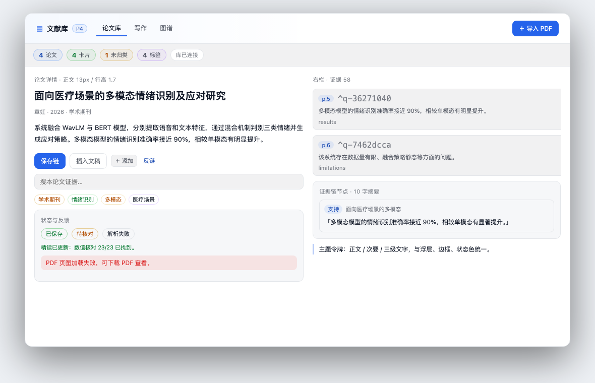

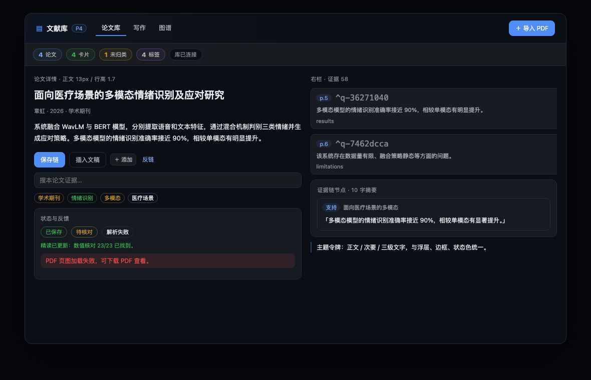

> 真实 DSH 页面需要重启后复核；这两张是 P0 令牌与组件的对照版。

### P0 已知待办（进 P1–P4）

- 图谱 Cytoscape 调色板尚未双主题（P3）；
- 列表行高、右栏证据行高、页签密度还是旧值（P1–P2）；
- 骨架屏、键盘焦点 trap、窄屏抽屉（P1–P4）；
- 状态/标签的 JS 调色板仍含 hex（P3 集中为 `GRAPH_PALETTE` / `TONE_PALETTE`）。


---

## 10. P1 已实施（v0.20.0，2026-11-06）

| 项 | 结果 |
|---|---|
| 头部 | 两行：上行 brand + 论文搜索 + 导入；下行页签 + KPI（可点筛选） |
| 搜索 | 标题/作者/刊名/标签/DOI 客户端过滤；空态按关键词提示 |
| KPI | 论文/卡片/未归类/标签；点击切换筛选；<=1100px 自动收起 |
| 列表行 | 82px 起；状态点 + 两行标题 + 刊/年/作者 + 类型/标签 + 状态胶囊；七段卡标记 |
| 列表加载 | 5 行 shimmer 骨架，不再只写「加载中…」 |
| 详情头 | 标题 + 作者/年/刊/类型 + 状态 + 「打开原文」+ 页签；两行结构，内容区独立滚动 |
| 窄屏 | 头部搜索独占一行；KPI 收起；列表/右栏仍按旧逻辑折叠（抽屉在 P4） |
| 测试 | `npm test` **90 项全过**；新增头部/骨架/行/详情头断言 |

浅色 / 深色对照：

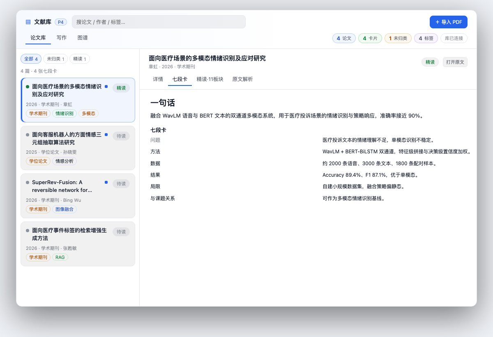

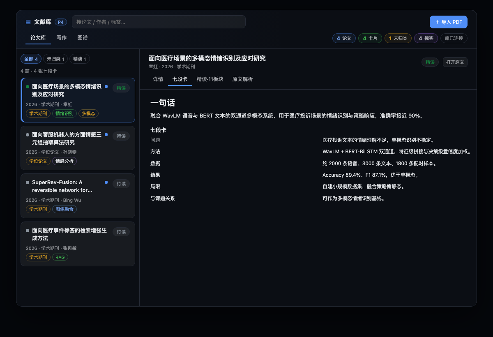

### P1 已知待办（进 P2–P4）

- 右栏四页签、证据行 72px、精读小节导航（P2）；
- 写作页三栏/AI composer、图谱双主题（P3）；
- 窄屏列表/右栏抽屉、焦点 trap、六张截图矩阵（P4）。


---

## 11. P2 已实施（v0.21.0，2026-11-06）

| 项 | 结果 |
|---|---|
| 右栏页签 | 高度 32px，字号 12px，计数保留；激活下划线 |
| 证据行 | 76px 起；`p.N` 胶囊、引文 2 行、来源 meta、右侧「建链」 |
| 精读导航 | 左侧 sticky 11 板块 + 数值核对 + 论点与证据链；点击滚动，滚动高亮当前板块 |
| 精读正文 | 按板块分节渲染，13px/1.85；页码/q-id 引用仍可点 |
| 解析稿 | 选中态改为左侧 accent 竖线 + 浅底；hover/选中显示「追问 / 建链」；正文 13px |
| 测试 | `npm test` **90 项全过**；新增精读小节导航断言 |

浅色 / 深色对照：

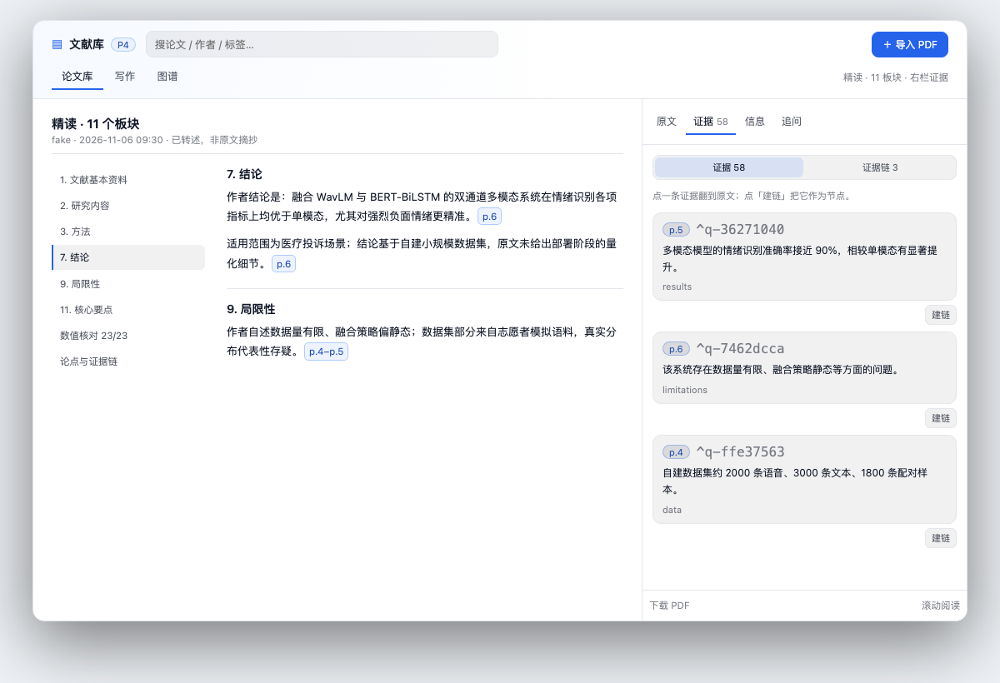

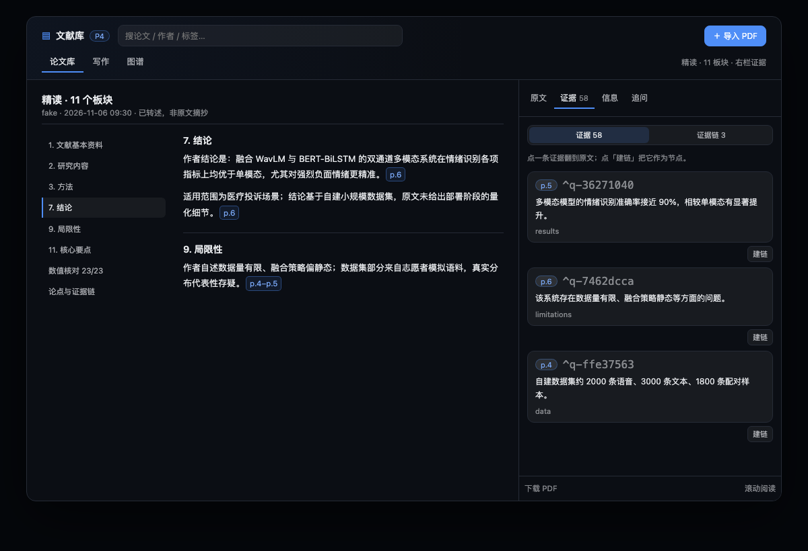

### P2 已知待办（进 P3–P4）

- 写作页三栏/AI composer、图谱浅深双调色板（P3）；
- 窄屏列表/右栏抽屉、焦点 trap、六张截图矩阵（P4）。


---

## 12. P3 已实施（v0.22.0，2026-11-06）

| 项 | 结果 |
|---|---|
| 写作 | 三栏 250/1fr/330；工具栏分组 + 分隔线；「专注」隐藏文稿列表/右栏；预览最大 860px |
| AI 扩写 | 右栏新增「AI 扩写意图」输入；按意图生成并插入，仍只允许选中证据 |
| 图谱 | 浅/深两套 Cytoscape 调色板；运行时检测主题并重建样式；画布点阵/浮层/tooltip 跟随主题 |
| 弹窗 | 建链弹窗沿用 token/双栏，与全局一致（无新增交互） |
| 测试 | `npm test` **90 项全过**；Cytoscape 浅/深样式无警告 |

写作：

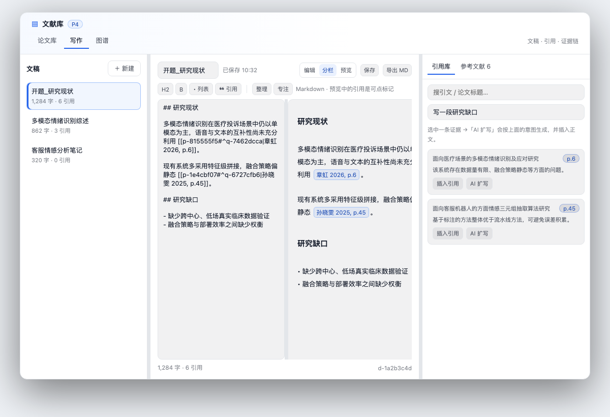

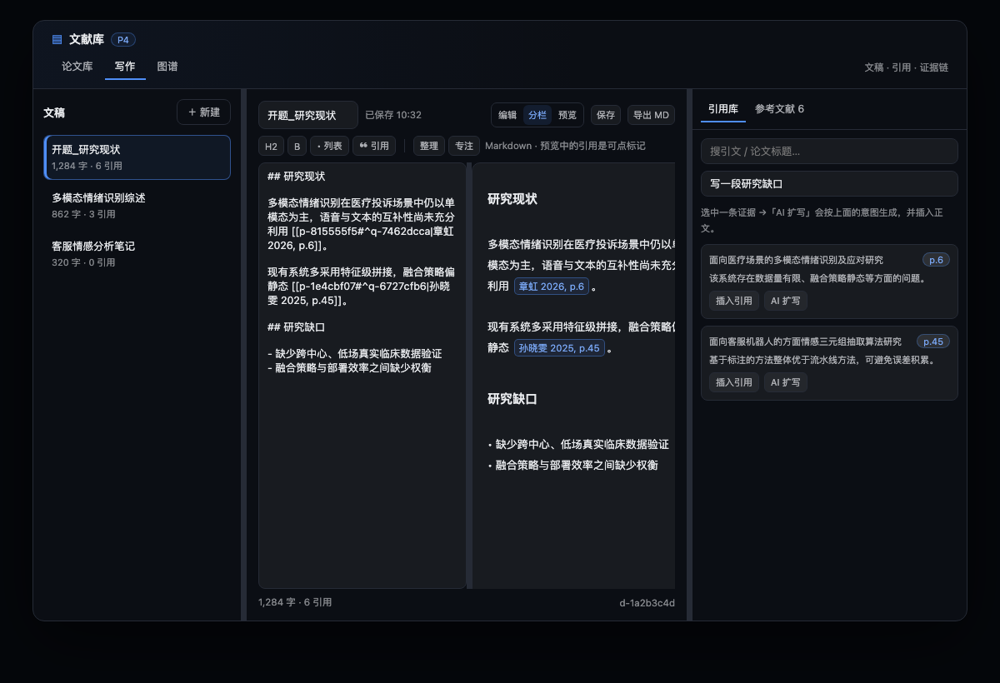

图谱：

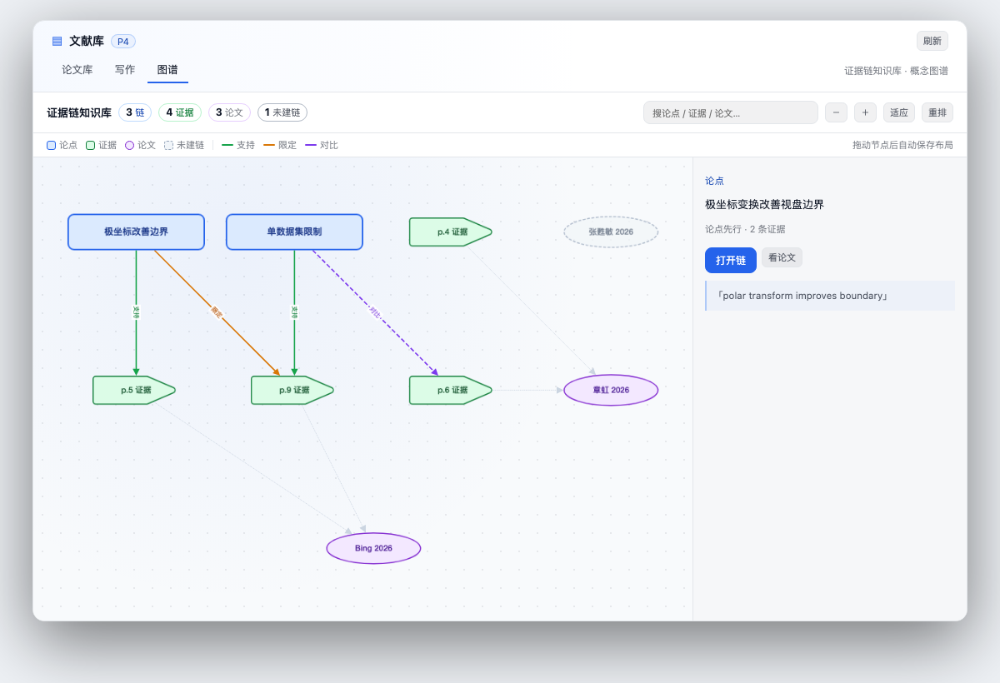

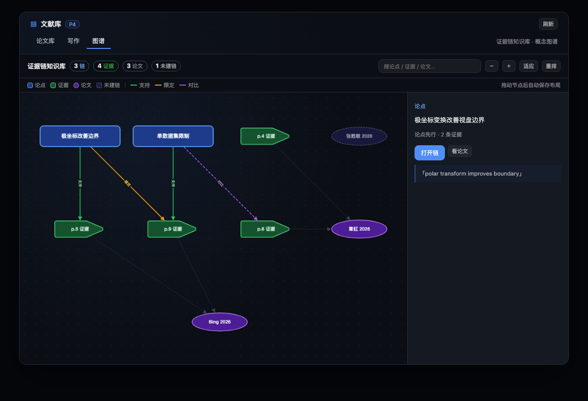

### P3 已知待办（进 P4）

- 窄屏列表/右栏抽屉、焦点 trap、键盘走查；
- 六张截图矩阵（1280/1440/1920 × 浅深）、对比度脚本；
- 写作/图谱真实数据下的边界状态（长标题、空稿、0 链）。


---

## 13. P4 已实施（v0.23.0，2026-11-06）

| 项 | 结果 |
|---|---|
| 窄屏列表 | <1260px 页头出现「论文列表」；点击打开左侧抽屉，Esc/遮罩关闭 |
| 窄屏右栏 | <980px 页头出现「原文与证据」；打开 PDF/证据时自动打开右侧抽屉（宽 min(560px,94vw)） |
| 焦点 | 建链弹窗自动聚焦论点、Tab 循环、关闭后焦点回到触发元素 |
| 对比度 | `--litkb-text-3` 55%→60%；浅色三级文字 3.96→4.68:1 |
| 键盘 | Esc 优先级：列表抽屉/右栏抽屉 → PDF 查看 → 选中 → 管理页 → 关闭工作区 |
| 测试 | `npm test` **90 项全过**；`npm run check` 通过 |

### 对比度实测（模拟宿主令牌）

| Token | 浅色 | 深色 |
|---|---|---|
| 正文 | 17.74 | 15.74 |
| 次要 text-2 | 7.03 | 8.40 |
| 三级 text-3 | 4.68 | 6.10 |
| accent | 5.17 | 6.02 |
| accent-text | 7.48 | 7.95 |
| success | 5.02 | 7.60 |
| warn | 5.02 | 7.65 |
| danger | 4.83 | 5.76 |

全部 ≥ 4.5:1（AA 正文）。

### P4 剩余（需真实宿主）

- 1280/1440/1920 三档 × 浅/深六张真实截图（当前为 1200 基准静态对照 + CSS 断点）；
- 触屏长按/拖拽、Safari 兼容、真实长标题/空库边界；
- 可选：`prefers-reduced-motion` 全面走查。


---

## 14. 反馈修复（v0.24.0，2026-11-06）

| 反馈 | 处理 |
|---|---|
| 图谱悬浮框文字看不清 | tooltip 背景从固定深底改为 `--litkb-surface-2`，文字/元信息/类型全部走 token；浅色下为浅底深字 |
| 写作编辑窗口不能拖 | 三栏新增两个 6px 拖拽条（文稿 / 编辑 / 引用），编辑-预览之间再一个拖拽条；宽度与比例写 localStorage |
| 概念图谱需优化 | 旧 Canvas 迁移到 Cytoscape：浅/深双调色板、节点拖拽、滚轮缩放、hover 提示、点击选中、图例与右侧详情保留 |

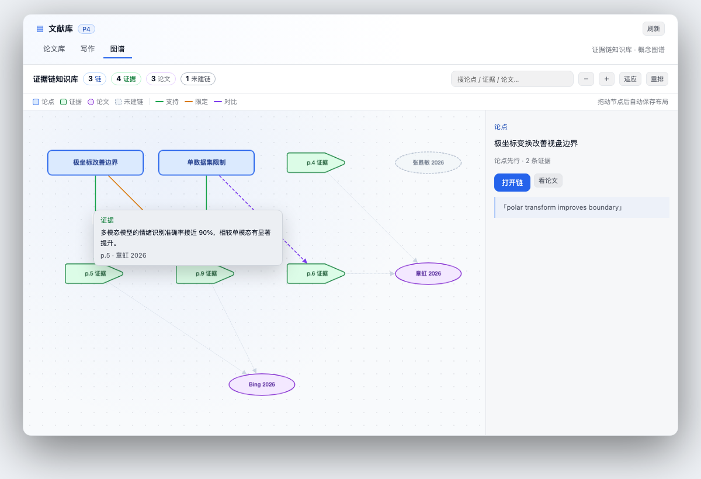

概念图谱（Cytoscape）：

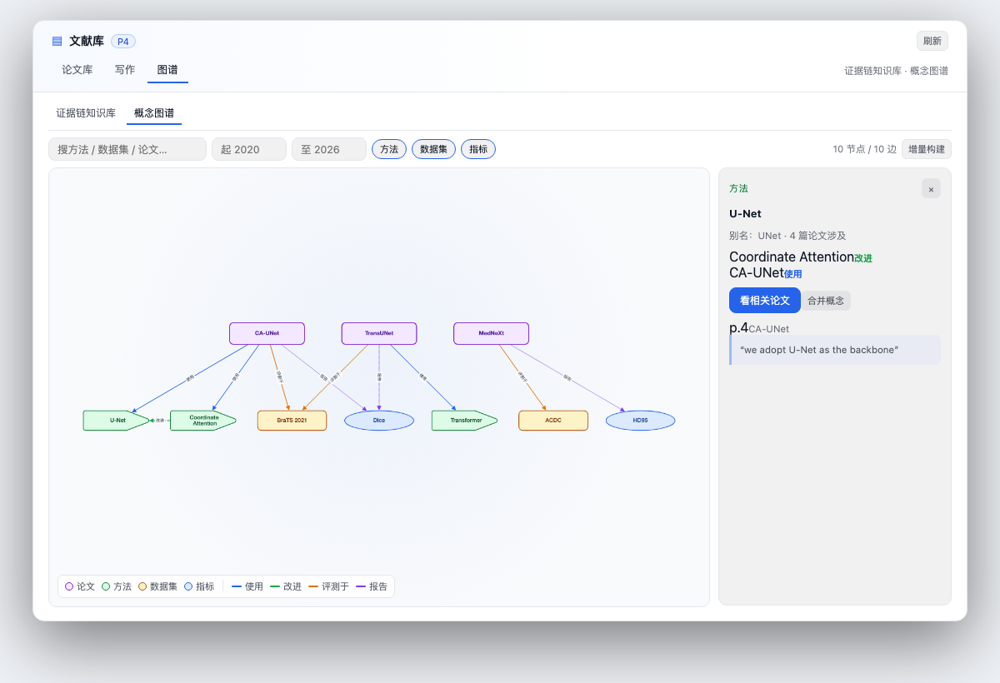

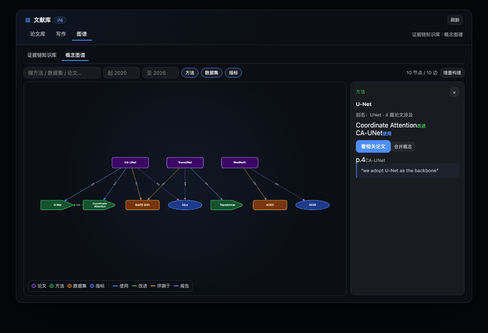

写作三栏与编辑/预览拖拽（更新版）：


### 备注

- 概念图谱的节点位置保存在 `localStorage`（`litkb.conceptPositions`），不写服务器；
- 写作宽度键：`litkb.writeDraftWidth` / `litkb.writeRailWidth` / `litkb.writeSplit`；
- `computeForceLayout`/`drawGraph` 保留给旧测试与潜在回退，但页面不再使用 Canvas 绘制。
