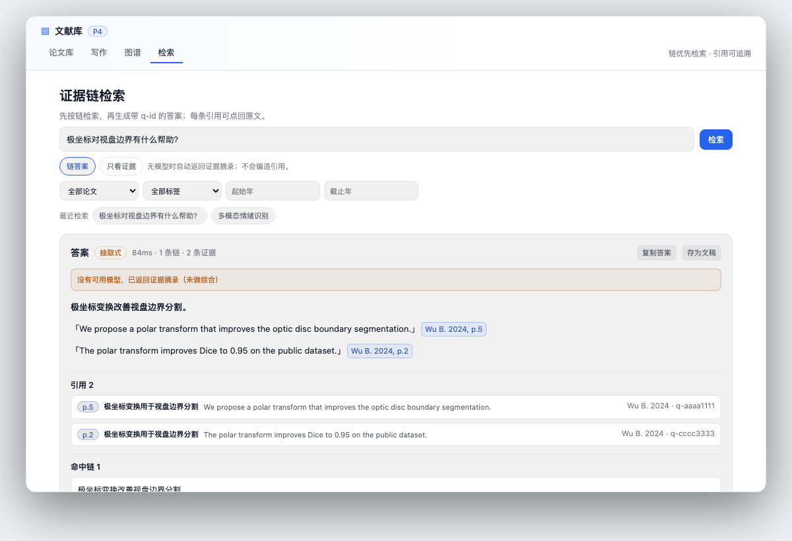
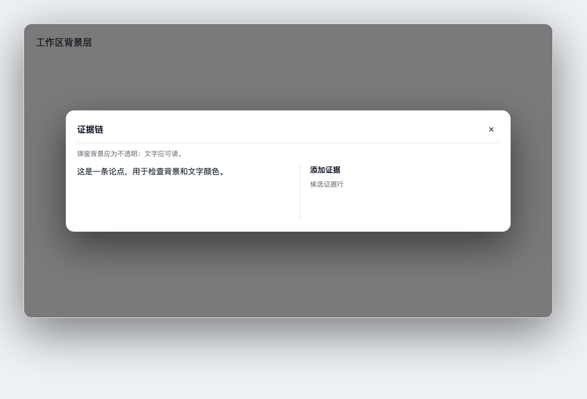
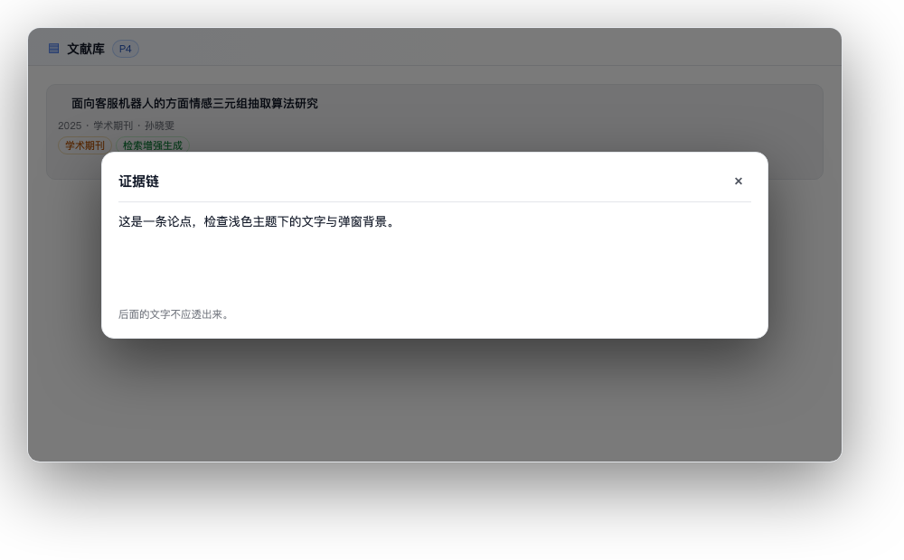
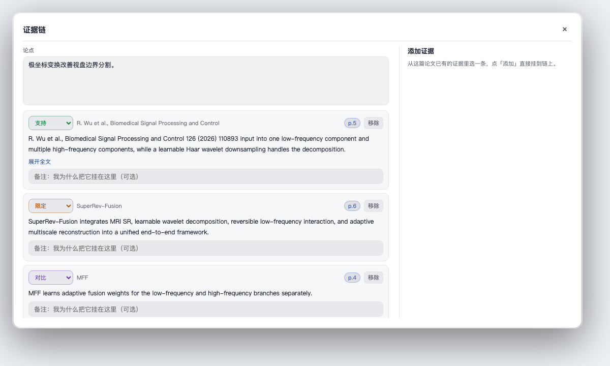

# P4.11 链增强 / 检索 / Agent 工具 · 交付单

| 项 | 内容 |
|---|---|
| 版本 | **v0.1.1**（内部迭代 0.28.4） |
| 日期 | 2026-11-06 |
| 状态 | A 自动建链、P1 跨论文链（含主题/概念强配对）、P2 检索产品化、P3 Agent 工具、链接导入、横向精读、检索历史 50 条、D 30 篇规模回归 已完成 |
| 测试 | `npm test` **116 项全过**；`npm run check` 通过；63 条 HTTP 路由 |
| 真实库干跑 | 3 篇有精读的论文各产出 8 条 draft；每条节点全部锚定库内 q-id |

---

## A. 自动建链（draft + 审核）

### 流程

```text
精读板块（结论/创新点/局限/核心要点）
  → extractClaims 抽候选论点（必须带 q-id 或 p.N）
  → proposeFromClaim 锚定证据（q-id 优先，同页兜底）
  → cueRelation 标 supports / qualifies / contradicts
  → 去重（同 claim 已有链则跳过）
  → saveChain(status=draft, origin=auto, confidence, provenance)
  → 审核：accept / reject（merge API 已留）
```

### 数据字段

链新增：

```json
{
  "origin": "auto",
  "status": "draft",
  "confidence": 0.9,
  "topic": "情绪识别",
  "paperIds": ["p-..."],
  "provenance": {
    "runId": "run-...",
    "promptVersion": "chain-auto.v1",
    "sections": ["conclusion"],
    "extractedAt": "..."
  },
  "relations": [],
  "review": null,
  "warnings": []
}
```

### 接口

| 方法 | 路径 | 说明 |
|---|---|---|
| POST | `/api/litkb/chains/auto/run` | `{scope:'library'|'paper', paperIds, sections, autoConfirm}`，后台任务 |
| GET | `/api/litkb/chains/auto/jobs?id=` | 进度、created/skipped/failed、items/errors |
| GET | `/api/litkb/chains/review` | 所有 draft 链（含 paperTitle） |
| POST | `/api/litkb/chains/review` | `accept` / `reject` / `merge` |

### 前端

- 图谱页头部「自动建链 / 审核」→ 弹窗；
- 选择板块、是否高置信度自动确认（默认关）；
- 进度条 + 待审队列：确认 / 拒绝 / 查看；
- 确认后图谱刷新；拒绝删除草稿；
- 重跑不覆盖/重复已有链（已测）。

### 安全边界

- 没有 q-id 证据不建链；
- 默认 draft，人工确认后才 confirmed；
- `autoConfirm` 仅在用户主动勾选时，阈值 0.8；
- 自动链不参与检索答案（`search.js` 默认过滤 draft）。

---

## B. BM25 链级检索 + 可追溯答案

### 索引

- `lib/search.js`，纯 JS，无向量库/外部依赖；
- 文档：证据（quote/title/tags）与链（claim/title/node quotes）；
- 字段权重：证据 3、claim 3、标题 2、作者/标签 1、节点引文 1；
- 中文：`Intl.Segmenter` + 二元组；英文/数字按词；
- BM25：k1=1.2, b=0.75；30 篇/300 证据实测 18–21ms；
- 默认只检索 confirmed 链，draft 不进答案。

### 答案

- `lib/answer.js`；链优先，证据兜底；
- 有模型：`prompts/chain-answer.v1.md`，只允许材料内 q-id；
- 无模型：抽取式答案（quote + 引用），不生成无依据句子；
- 引用校验：q-id 白名单、逐句引用检查、无效引用标记/剔除；
- 返回：`answer / citations / chains / trace / warnings / mode`。

### 接口

| 方法 | 路径 | 说明 |
|---|---|---|
| GET/POST | `/api/litkb/search` | `{q,paperId,tag,yearFrom,yearTo,limit}` → evidence + chains + took |
| GET/POST | `/api/litkb/search/answer` | 链答案 + citations + trace |

### 前端

新增「检索」页签：

- 链答案 / 只看证据；
- 答案 Markdown + 引用 chip；
- 引用列表点击回原文；
- 命中链点击打开链弹窗；
- 「为什么是这些证据」展示 chain/evidence/score/matched。



---

## C. Agent 工具（7 个）

| 工具 | 权限 | 说明 |
|---|---|---|
| `lit_search` | 只读 | 链/证据检索 |
| `lit_answer` | 只读 | 链优先答案 + citations + trace |
| `lit_chain_get` | 只读 | 读链 |
| `lit_chain_propose` | 只读 | 生成链草稿，不保存 |
| `lit_chain_save` | 写 | 必须 `confirm:true` |
| `lit_card` | 只读 | 七段卡 + 证据 |
| `lit_cite` | 只读 | 按 q-id 返回引用块 |

- 通过 `ctx.get('tools').register()` 注册；工具名 `lit_*`；
- 输出结构化 JSON；`lit_answer` 渲染为答案文本；
- 写工具未确认返回 `requiresConfirmation`，不落库；
- 系统提示需约束模型只引用工具返回的 q-id。

---

## D. 回归与打包

- 新增测试：自动建链（1）、自动建链路由/审核（1）、BM25（3）、答案（2）、检索路由（3）、工具（3）、30 篇规模（2）；
- `npm test` **116 项全过**；`npm run check` 通过；路由 **63** 条；
- 30 篇/300 证据：检索 18–21ms，抽取式答案带引用；
- `npm pack` 产出 `dsh-litkb-0.1.1.tgz`。

### 仍待

1. LLM 重排 / 语义召回（BM25 + 链优先已可用）；
2. 真实 30 篇人工验收与真实宿主截图/触屏走查；
3. Agent 工具在真实对话中的端到端验收（需重启 DSH）；
4. 文件夹监控、队列取消、整库 vault/双语导出。


---

## v0.25.1 紧急修复（2026-11-06）

UI 令牌层出现自引用：

```css
--litkb-bg: var(--litkb-bg);
```

导致 `--litkb-bg / border / text / accent` 等在真实宿主中全部失效，弹窗背景透明，后面的详情抽屉和证据栏文字透出来形成“叠字”。已改为映射宿主令牌：

```css
--litkb-bg: var(--dsw-alias-bg-base, #0b0e14);
--litkb-text: var(--dsw-alias-label-primary, #e6e8eb);
...
```

并补齐 `--litkb-accent-text` / `--litkb-violet` / `--litkb-violet-text`。验证图 `docs/assets/ui-tokenfix.png`：弹窗不透明、文字可读。




---

## v0.25.2 主题修复（2026-11-06）

v0.25.1 修了令牌自引用后，真实宿主仍出现“深色面板 + 深色文字”，原因是宿主 `--dsw-*` 变量在插件面板作用域下不可靠，且部分文字继承宿主颜色。

修复：

- `Workspace` 读取宿主 `body` 背景/文字亮度，设置 `litkb-theme-light` / `litkb-theme-dark`；
- 两个主题类在面板和窗口上显式给全套 `--litkb-*`，不再依赖宿主变量兜底；
- `.litkb-panel` 显式 `color:var(--litkb-text)`，避免继承宿主深色文字；
- 链弹窗从令牌选择器中移除，继承窗口主题，避免再次自建令牌。




---

## v0.25.3 概念图谱修复（2026-11-06）

- 概念图谱主题检测改为在 **图容器出现后** 重跑（依赖 `view/loading/nodeKey`），不再默认深色；
- 新增 `ResizeObserver` + 初始化后 `cy.resize()/fit()`，解决“节点缩在左上角、周围大片空白”；
- `cose` 布局提高斥力/边长，`layoutstop` 后自动 fit；
- 节点位置 key 升为 `litkb.conceptPositions.v2`，丢弃旧的小坐标布局；
- 概念图工具栏新增 **适应 / 重排**。


---

## v0.25.4 建链节点行优化（2026-11-06）

- `.litkb-chainRel` 被 `.litkb-input{width:100%}` 覆盖，关系下拉占满整行；改为 `.litkb-chainRel.litkb-input{width:88px}`；
- 关系按 supports/contradicts/qualifies/derives/compares 分色；
- 节点顶行固定为「关系 / 论文 / p.N / 移除」；
- 引文默认 3 行，长引文提供「展开全文 / 收起」；
- 备注输入保持一行，行高收紧。




---

## P1 跨论文自动链 + 检索历史（v0.26.0，2026-11-06）

### 跨论文自动链

- 新模块 `lib/chain-cross.js`：抽取各论文 claim → 字面相似度（中文二元组 + 英文词）→ 跨论文配对；
- 关系规则：
  - 数字不同 → `compares`
  - 一侧有“仅/局限/单一/小样本” → `qualifies`
  - 一侧有否定/相反 → `contradicts`
  - 其余 → `supports`
- 合成 claim：`关于「主题」，不同论文的结论存在冲突/可对比/多篇一致`；
- 两侧都必须用 `proposeFromClaim` 锚定到 q-id，任何一侧无证据不建链；
- 输出 `origin=auto, status=draft`，进同一审核队列；
- 同 pair/同合成 claim 去重；每次最多 8 条，避免刷屏；
- 入口：自动建链弹窗 →「跨论文对比 / 矛盾」；API `/chains/auto/run` `mode:'cross'`。

### 检索历史

- `lib/search-history.js` 落盘 `<库>/cache/search-history.json`；
- 保留 **最近 50 条**，至少 10 条可用；空查询不记；
- 记录 q/mode/filters/chainIds/evidenceIds/citations/took/at；
- `/search`、`/search/answer`、`lit_search`、`lit_answer` 都自动记录；
- 新增 `GET /api/litkb/search/history?limit=10`；
- 检索页展示「最近检索」10 条，点击重跑。

验证：`npm test` 112 项；跨论文 3 项、历史 3 项、跨论文任务 1 项。


---

## P2 检索产品化（v0.27.0，2026-11-06）

- 检索页新增过滤：**论文 / 标签 / 起始年 / 截止年**，与 BM25 请求一起下发；
- 答案区新增 **复制答案**、**存为文稿**；
- 「存为文稿」创建 `检索：<问题>` 草稿并切到写作页，答案里的 q-id 引用原样保留；
- 检索历史继续自动记录（含过滤条件），最近 10 条一键重跑；
- LLM 重排仍未接（BM25 + 链优先答案已可用，重排列为可选增强）。

## P3 Agent 工具（v0.27.0）

- `lit_answer` 的 `output.render` 现在返回 **答案 + 引用列表**（p.N / 论文 / q-id），不再只回一段裸文本；
- 7 个工具仍为只读 + `lit_chain_save` confirm；`lit_search/lit_answer` 自动写检索历史；
- 工具 schema、执行、confirm 分支均有测试；真实宿主端到端仍需重启后走查。

## 主题/概念强配对（v0.27.0）

`lib/chain-cross.js` 在字面相似度之外增加：

- 同 `topics` 标签的论文 claim 强配对；
- 共享概念（概念图谱 paper→concept 边）的论文 claim 强配对；
- 默认关系改为 `compares`，带 `provenance.strongPair` 和“请重点核对”警告；
- 当前 4 篇真实库干跑出 **1 条**跨论文 draft（主题「检索增强生成」，字面相似度 3%），说明不靠字面相似也能配。

验证：`npm test` **112 项全过**；`npm run check` 通过；61 条路由。


---

## v0.27.1 入口位置（2026-11-06）

- 论文库列表行右侧新增 **「自动建链」/「审核」**（选中或 hover 行时显示）；
- 「自动建链」按当前论文 `scope:'paper'` 运行，打开审核弹窗；
- 「审核」打开全局待审队列；
- 图谱页原有「自动建链 / 审核」保留，供整库/跨论文使用；
- 弹窗支持 Esc 关闭。

`npm test` 112 项全过；版本 0.27.1。


---

## v0.27.2 自动建链兜底（2026-11-06）

问题：论文只有七段卡、没有精读时，自动建链直接报「还没有精读」。

修复：

- `autoChainDrafts` 优先用精读 claim；
- 无精读时用七段卡的 `oneLine / problem / method / results / limits` 候选句；
- 证据从卡内 `section.evidence` q-id 取；无 section 证据时按关键词兜底；
- `provenance.source='card'`，warning 提示「建议补精读后复核」；
- 重新对截图论文 `p-26596c2d` 干跑：**8 条 draft，全部锚定 q-id**。

`npm test` 112 项全过；版本 0.27.2。


---

## 场景补齐（v0.28.0，2026-11-06）

### DOI / arXiv / 链接导入

- 新 `lib/link-import.js`：自动识别 URL / DOI / arXiv ID；
- DOI 先查 Crossref 元数据，再找开放 PDF；拿不到 PDF 明确报 `no_pdf`，不抓 HTML 冒充；
- 普通网页解析 `citation_pdf_url` / `citation_title` / `citation_author`；
- 下载后走同一 `importPdfBuffer`：SHA 去重、PDF 解析、分类、写卡片；
- 前端论文库头部「链接 / DOI」弹窗，支持自动识别、PDF 链接、DOI、arXiv。

### 多论文横向精读

- `GET /api/litkb/deepread/compare?ids=p1,p2`：合并 11 板块，返回每篇的 section markdown；
- 图谱页新增「横向精读」；选 2–4 篇，表格并排；未精读列明确标「未精读」；
- 单元格保留 q 引用，可点回原文。

### Agent 工具补到 9 个

新增：

- `lit_graph`：论文/概念/边，按论文过滤；
- `lit_blocks`：解析稿块（页码/角色/章节/bbox/文本）。

验证：116 项测试；链接解析 3 项、横向 compare 1 项、工具 schema 9 个。


---

## v0.28.1 横向精读兼容（2026-11-06）

现象：横向精读 HTTP 404。检查运行中服务 `/health` 仍是 **0.27.1**，新 `/deepread/compare` 路由尚未加载。

处理：

- 前端 `ComparePanel` 先调 `/deepread/compare`；
- 若 404/不可用，自动退回逐篇 `/deepread?id=`，在客户端合并 11 板块；
- 这样旧服务端也能出横向表；完整 0.28.x 服务端重启后走新接口。

验证：116 项测试全过；版本 0.28.1。


---

## v0.28.2 横向精读差异增强（2026-11-06）

- 每行按文本相似度 / 数字差异自动标「文本差异 / 数字差异」；
- 数字以 chips 展示，未在另一篇出现的数字标橙；
- 「只看差异」过滤无差异板块；
- 板块可折叠；
- 每个板块可「对比链」：取两侧 q-id 生成 evidence-mode 链草稿；
- 「存为文稿」把当前可见对比表写成 Markdown 草稿并切到写作页。

`npm test` 116 项全过；版本 0.28.2。


---

## v0.28.3 横向表格显示修复（2026-11-06）

问题：横向精读只能显示前几行，下面内容被裁掉。

根因：新横向表复用了旧组件类名 `litkb-compareTable`，而旧 CSS 有：

```css
.litkb-compareTable { display:flex; flex-direction:column; overflow:hidden; }
```

把 `<table>` 强制改成 flex 列并裁切内容。

修复：

- 新横向表改名 `litkb-compareGrid`；
- 旧概念对比表保留 `litkb-compareTable`；
- 表格恢复 `border-collapse` + 自动行高，外层 `litkb-compareScroll` 负责滚动。

版本 0.28.3；`npm test` 116 项全过。


---

## v0.28.4 导航重排（2026-11-06）

- 论文详情页签：`精读·11板块` → **`精读`**；
- 精读左侧 11 板块导航新增 **「隐藏导航 / 显示导航」**，隐藏后正文占满宽度；
- **概念图谱暂时隐藏**：GraphPanel 只保留证据链知识库；`ConceptGraphPanel` 组件与接口保留，后续恢复；
- **横向精读独立为顶层页签**，不再藏在图谱页；顶层顺序为：
  `论文库 / 横向精读 / 图谱 / 写作 / 检索`。

`npm test` 116 项全过；版本 0.28.4。
