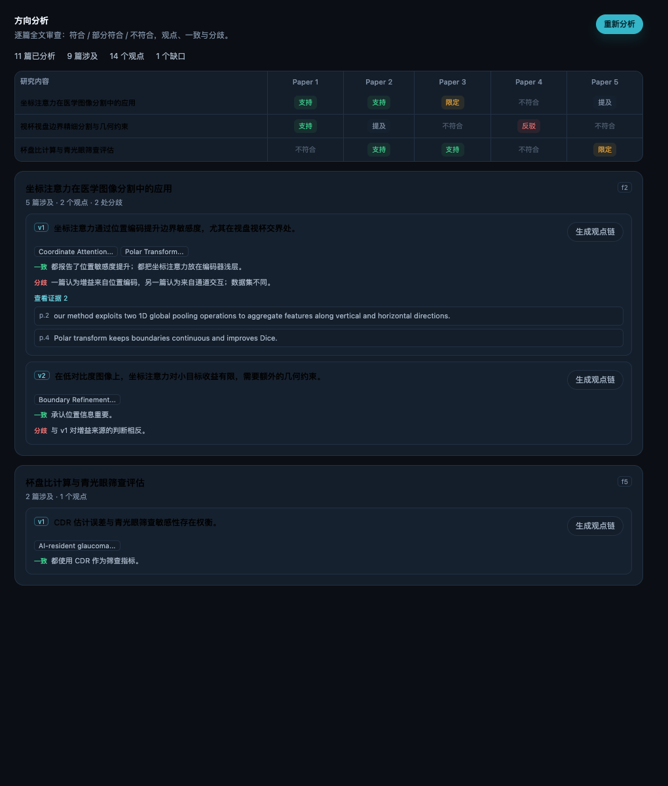

# 方向分析与观点链（v0.16.0）

> 论文入库后先精读；一旦进入某个研究方向，就按研究方向对整篇论文做一次审查：
> 哪些内容符合、哪些不符合；每篇论文是什么观点；观点之间一致在哪里、分歧在哪里。

| 项 | 内容 |
|---|---|
| 版本 | v0.16.0 |
| 入口 | 研究工作台 → 单个研究 →「方向分析」 |
| 数据 | `themes/analysis/<themeId>.json` |
| 路由 | `/themes/analyze`、`/themes/analysis`、`/themes/analysis/chain`、`/themes/analysis/cancel` |
| 依赖 | 七段卡、精读、全文 blocks、模型 |
| 原则 | 全文审查、q-id 可回贴、观点可比较、人工确认 |

---



## 1. 与旧主题建链的区别

| | 旧主题建链 | 方向分析 |
|---|---|---|
| 输入 | facet 查询 + BM25 | 整篇论文 + 全部研究内容 |
| 输出 | 一条 facet 链（top 4 引文） | 每篇论文的符合度/立场/观点，再聚类成观点 |
| 是否判断“不符合” | 只会召回，不会显式排除 | 明确标 not_relevant / relevance 0 |
| 是否比较多篇观点 | 不比较 | viewpoints + agreements + disagreements |
| 证据 | 卡片已有 q-id | 卡片 q-id + 全文新引文回贴生成 q-id |
| 结果 | draft 链 | 分析矩阵 + 观点卡 + 可生成观点链 |

旧链保留为快速候选；方向分析是“研究内容”的主结果。

## 2. 处理流程

```text
研究方向 + 细分描述
  ↓ 每篇论文读全文
研究内容 × 论文：relevance / stance / summary / claims
  ↓ 每条研究内容汇总
观点簇：statement / papers / evidence / 一致 / 分歧
  ↓ 人工审核
观点链 confirmed
  ↓
研究结论 / 提纲
```

### 2.1 逐篇全文审查

对每篇论文 × 每条启用的细分描述输出：

```json
{
  "relevance": 3,
  "stance": "supports | contradicts | qualifies | mixed | mentions | not_relevant",
  "summary": "这篇论文在该研究内容上的观点",
  "rationale": "为什么符合/不符合",
  "claims": [
    {
      "text": "观点句",
      "role": "method | data | metric | result | limitation | definition | comparison",
      "evidenceIds": ["q-..."]
    }
  ]
}
```

- relevance：0 不符合/未涉及，1 只提及，2 部分符合，3 直接相关；
- 没有涉及就明确 `not_relevant`，不硬凑观点；
- 每篇最多 3 条观点，每条尽量绑定 q-id。

### 2.2 全文证据

- 输入包含：论文元数据、七段卡摘要、精读摘要、候选 q-id 表、全文节选（最多 60k 字符）；
- 模型优先从候选 q-id 选证据；
- 候选之外的新引文必须给 `quote + page`，服务端用 `locateQuote` 回贴原文，成功后生成 q-id 并写回卡片；
- 回贴失败就丢弃该证据并标“无 q-id”，不允许编造；
- 每篇最多新增 24 条证据。

### 2.3 观点聚类

每条研究内容把涉及论文的观点合成 1–5 个观点簇：

```json
{
  "viewpoints": [
    {
      "id": "v1",
      "statement": "观点句",
      "papers": ["p-a", "p-b"],
      "evidence": [{ "paperId": "p-a", "evidenceId": "q-...", "page": 2, "quote": "..." }],
      "agreements": ["一致点"],
      "disagreements": ["分歧点"]
    }
  ],
  "agreements": ["整条研究内容的一致点"],
  "disagreements": ["整条研究内容的分歧点"],
  "gaps": ["缺口"]
}
```

- 观点只允许引用涉及的论文和 q-id；
- 只有 1 篇论文时也可以有观点，但会提示“无法做跨论文比较”；
- 没有涉及论文时标缺口，不建空链。

## 3. 观点链生命周期

- 「生成观点链」把观点写成 draft 链：`claim = viewpoint.statement`，节点 = 观点证据；
- `provenance.viewpointId` 是幂等键：
  - 同一观点已有 draft → 原地更新；
  - 同一观点已有 confirmed → 新建补充草稿，不覆盖；
- 审核 accept：
  - 观点链只和**同一 viewpointId** 的 confirmed 合并；
  - 不会并进 facet 主链，避免多个观点被合成一条；
- 一个观点最多一条 confirmed；一个研究内容可以有多条不同观点的 confirmed；
- 研究结论/提纲会按“观点 1/2/…”列出。

## 4. 界面

### 4.1 方向矩阵

行 = 研究内容，列 = 论文编号 `P1..Pn`；完整标题放在矩阵下方图例，避免列头截断。

单元格用符号 + 颜色：

```text
✓ 支持   △ 限定   ✕ 反驳   ◐ 混合   · 提及   — 不符合
```

- 行头显示「相关 N + ✓/△/✕ 计数」；
- 默认只显示有相关内容的论文，可勾选「显示全部论文」；
- 点单元格看该论文在该研究内容上的摘要、理由与观点证据；
- 删除论文后，列、观点 papers、evidence、计数与 stats 自动清理。

### 4.2 观点卡

每条研究内容下面：

- 观点句；
- 涉及论文；
- 一致点（绿）/ 分歧点（红）；
- 展开证据（页码 + 原文）；
- 「生成观点链」按钮。

### 4.3 缺口

没有涉及论文，或只有一篇论文无法比较时，明确显示缺口；不生成空链。

## 5. API

| 方法 | 路径 | 说明 |
|---|---|---|
| POST | `/api/litkb/themes/analyze` | 启动分析；body `{id, paperIds?, facetKeys?, retryFailed?}` |
| GET | `/api/litkb/themes/analysis?id=` | 读取分析结果 + 最近任务 |
| POST | `/api/litkb/themes/analysis/chain` | 观点生成草稿链；body `{id, facetKey, viewpointId}` |
| POST | `/api/litkb/themes/analysis/cancel` | 停止分析任务；body `{id}`（任务 id） |

分析任务在服务端串行执行：逐篇审查 → 逐条观点对比 → 保存 `themes/analysis/<id>.json`；每篇/每条保存一次，失败可保留部分结果。

## 6. 边界

- 分析需要模型；无模型时任务失败，不生成假结果；
- 长论文一次输出全部研究内容可能触发 max-tokens：v0.16.1 起预算 32768，仍截断则自动逐条研究内容重跑；
- 观点综合也可能截断：v0.16.2 起预算 32768，仍截断用紧凑 prompt 重试，最后回退为逐篇观点并标 `fallback`；
- 失败/缺失的 facet 可点「重试失败项」，只重跑该 facet，不重读全部论文；
- 任务运行中可点「停止」，对应 `POST /themes/analysis/cancel`；已保存的论文分析不会丢；
- 全文最多 60k 字符，超出会截断并标记；需要完整全文时可后续做分段；
- 观点聚类是模型归纳，必须人工审核后才进入结论；
- 旧 BM25 主题链仍保留，但不应再作为研究方向的主结果；
- 分析不改变精读、七段卡和已有链。

## 7. 验收

1. 打开研究 →「方向分析」→「开始分析」；
2. 看到矩阵、观点卡、一致/分歧与证据；
3. 点「生成观点链」→ 证据链页出现 draft；
4. 审核 accept → `confirmed`；
5. 研究结论出现对应观点（一个研究内容可多条）；
6. 删除研究时 `themes/analysis/<id>.json` 一并清理。
